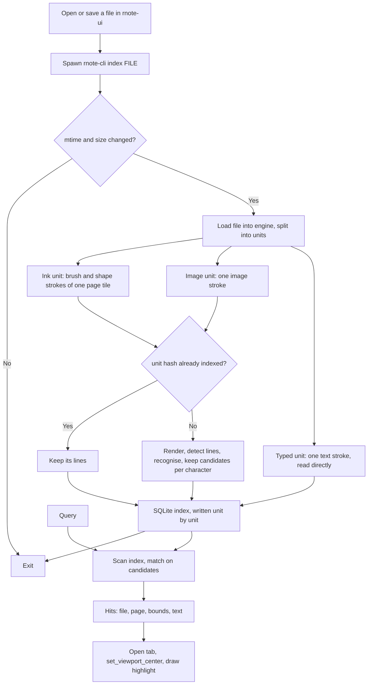

# TASK-001: On-device text recognition and search across notes — progress

Plan: [`rnote_ocr_search.md`](../../rnote_ocr_search.md). Chosen solution: **B** (indexer inside the fork, run as a subprocess), confirmed by the user on 2026-10-02 ("implement it all up to 1.6").

## Subtasks

| ID | Description | Status |
|----|-------------|--------|
| 1.1 | `rnote-ocr`: recognise one image, print lines with character boxes | Done |
| 1.2 | `rnote-ocr`: SQLite index and candidate search | Done |
| 1.3 | Engine: layered render | Done |
| — | **Checkpoint: user checks and commits after 1.3** | Committed as `c9d38b09` |
| 1.4 | CLI: `index` and `search` | Done |
| 1.5 | Engine: highlight overlay | Done |
| 1.6 | UI: search entry, results, jump, index after open and save | Done |
| 1.7 | Photos | Later |

Follow-up plan for zhuyin: [`task_002_zhuyin_progress.md`](task_002_zhuyin_progress.md).

## User decisions (2026-10-02)

- "when doing OCR second time we should only check places where it was changed. So maybe 4+ minutes for a single book isn't too much."
  → Indexing is **incremental per place**. A place ("unit") is one ink page or one image. Each unit has a hash of its content; a unit whose hash is already in the index is neither rendered nor recognised again.
- "It can start in the background when we open the file."
  → The UI spawns the indexer when a file is opened, not only after a save (1.6).
- Recognised units are written to the index as they finish, so an interrupted first run (several minutes for a book) resumes where it stopped.

## Flow

Previous flow: none — no search and no recognition exist.

New flow:



## Findings

### Sample file (`sample_docs/New Document.rnote`)

- Saved by rnote 0.14.2. 50 MB on disk, 134 MB of JSON. 112 `vectorimage` strokes (an imported PDF textbook, one stroke per PDF page, 0.2–8 MB of SVG each) and 500 `brushstroke`s. No typed text.
- Layout is **infinite**, page format 1123×1587 (A3 at 96 dpi). The PDF pages are 561×789 with a 16 px gap, so they do **not** line up with the page tiles: each tile cuts through PDF pages, and a 39 px sliver of every PDF page sits in the tile column to the left.
- Handwriting sits on top of the PDF pages (tile rows 5–19).

### `rnote-cli export doc-pages` is unusable as the render path

- **Slow:** 4 min 17 s wall, 13 min CPU for the sample at scale 1.0 (116 tiles). Every tile re-serialises all PDF pages it touches through cairo's SVG surface, then `usvg` simplify, then `rsvg`.
- **Wrong:** many PDF pages come out with large black areas (for example exported page 010, and the top PDF page on exported page 038).
  - Not the file: the stored SVG of each PDF page renders correctly when rendered on its own with librsvg (checked PDF pages 8, 9 → `tmp/svg/vi_008.png`, `tmp/svg/vi_009.png`).
  - Not caused by a PDF page being cut at the tile border: on exported page 010 both PDF pages lie fully inside the tile and are black; on page 038 the bottom PDF page is cut and is fine.
  - The broken pages are the ones that fill shapes with `<pattern>` elements (how the PDF's gradients and background images were stored). The export's SVG round-trip mangles those. Which of the two stages does it (cairo SVG surface or `usvg` simplify) is not pinned down; in a reproduction of only the cairo stage with system libraries, the black did not appear.
  - This is an upstream export bug, separate from this task. Not fixed here.

### Consequences for the design (deviations from the plan)

| Plan | Now | Why |
|---|---|---|
| Render with `StrokeContent::gen_svg(..)` then `.gen_image(scale)` | Draw straight onto a cairo image surface (`StrokeContent::draw_to_cairo`) | The SVG round-trip is the slow and broken part. Direct drawing is what the canvas does. |
| Image layer per page tile | Each image stroke is recognised on its own | A PDF page is one stroke. Tiles would cut its text lines and render each PDF page two or three times. |
| Ink layer per page tile | Unchanged | Lines cut at a tile border in infinite layouts stay an accepted edge case. |
| `ort` needs a system ONNX Runtime | `ort` downloads a prebuilt static ONNX Runtime at build time | No `onnxruntime-devel` on the machine, and Fedora's is 1.22. No system package to install. Costs a download during the first build. |
| `rusqlite` | `rusqlite` with `bundled` | No `sqlite-devel` on the machine. No system package to install. |
| Skip a file when mtime and size are unchanged, else re-recognise all of it | Same skip, then re-recognise only units whose content hash is new | User decision. A save of the sample would otherwise cost minutes each time. |
| `lines(file_id, page, source, …)` | `units(file_id, hash, page, source)` and `lines(unit_id, …)` | Needed for the above. |
| Detection at full resolution | Detection long side capped at 960 px; recognition crops still come from the full-resolution image | Memory, see measurements. |
| Index after save | Index after save and after opening a file | User decision. |
| Highlight rectangles set when a result is activated | Same; cleared on all tabs when the search entry is cleared | Otherwise they would stay until the tab closes. |
| Model files in the XDG data dir, fetched separately | Model files in the repository, compiled into `rnote-cli` | User decision ("build should auto build with models if licenses allow it"). Licences allow it. `just ocr-models` is gone. |
| Typed text: characters spread evenly over the line | Typed text: each character's real position from the text layout | Even spreading put highlights on the wrong characters in mixed Chinese and Latin lines; seen in the README screenshot. |
| Result list as a second list in the template layout | The results listbox takes the place of the files listview inside the existing scroller | No change to the grid that `appwindow` re-arranges when the sidebar switches sides. |

### Recogniser measurements (this machine, 4 cores, 2 threads used, debug profile at opt-level 2)

Input: one PDF page of the sample at scale 2.0 (1123×1577 px).

| Detection long side | Peak memory over loaded models | Detection | Whole page (32 lines of dense text) |
|---|---|---|---|
| 1600 (runs at 1120×1568) | +278 MB | 1.0 s | 4.3 s |
| 960 (runs at 672×960) | +110 MB | 0.4 s | 3.4 s |

- Loaded models alone: 80 MB resident.
- **Chosen: 960.** Same lines found and the same text quality on the two pages compared, at well under half the memory.
- Recognition dominates on dense pages: about 0.2 s for a full-width line of 35 characters, 15–20 ms for a short one. The plan's "0.9 s per page" does not hold for a textbook page; 3–4 s does.
- The plan's "+170 MB at 1588×2246" is not reproduced; memory here is about 160 MB per megapixel of detection input.
- Switching the memory arena and memory pattern on or off changed the peak by under 5% in a single-image run (342 MB against 357 MB). They stay off so memory is not retained between images of different sizes; the plan's "doubles the peak" is not reproduced.
- Reading quality on the sample's printed pages: Traditional Chinese body text and English read correctly. Chinese with zhuyin ruby beside each character gets junk characters between the real ones (`林号東氢明` for 林東明) because zhuyin is not in the dictionary; searching one character still hits, a multi-character query across ruby text does not. Text set on an arc is not found.
- Whole sample, first index: 112 PDF pages at 3–4 s is roughly 6 minutes. This is what the incremental indexing above is for.

### Layered render on the sample (1.3)

`Engine::extract_text_units` splits the sample into 131 units: 19 ink page tiles, 112 images, no typed text. Rendered with `StrokeContent::gen_image` at scale 2.0.

- Whole file, load plus render of all units plus PNG encoding: **19 s** (export path: 4 min 17 s). An ink tile renders in 25–90 ms, a PDF page in up to 0.8 s.
- The PDF pages that the export paints black render correctly (`tmp/units/025_page103_Image.png`, `tmp/units/052_page259_Image.png`).
- Peak memory of that run: 633 MB. This is loading the file (50 MB gzip, 134 MB JSON) into the engine, not rendering or recognition. It is the floor for indexing this file in any process and is not addressed here.
- Page numbers are positions in the full page grid of the document (empty pages count), so a fixed-size document gets its real page numbers. In the sample's infinite layout they run to 295 and mean little.

### Handwriting on the sample (ink units, detection at 960)

- Lines are found: 12 on `tmp/units/018_page295_Ink.png`, 0.7 s per tile, about 200 MB peak for the whole recogniser process.
- Reading is poor. The sample's handwriting is small Latin cursive (about 15 document px tall); `Aš Seima turi` comes out as `A5 Sime tui`, most other lines are not usable. Handwritten zhuyin practice rows come out as look-alike Chinese characters (`了万了弓了了`).
- No handwritten Chinese characters were found in the sample, so the plan's main use case is still unmeasured on real handwriting.

### CLI on the sample (1.4)

Run with an isolated data dir (`XDG_DATA_HOME=tmp/xdg`), debug profile.

| Case | Time | Peak memory |
|---|---|---|
| First index of the sample, all 131 units read | 3 min 20 s | 801 MB |
| Same file again, unchanged (mtime and size match) | 0.04 s | 20 MB |
| File touched, content unchanged: load, hash all units, read none | 3.0 s | 502 MB |
| `search` over the index (3,349 lines) | 0.04 s | 22 MB |

- The index for the sample is 3.7 MB.
- The peak is loading the 50 MB file, as measured in 1.3; recognition adds about 170 MB on top.
- Six small test files from `misc/file-tests` (dense typed-looking text as images, handwriting): 70 s together. Dense text lines dominate.
- Typed text is read without the models; they are only loaded once an ink or image unit needs reading.
- Files deleted from disk are dropped from the index on the next run of `index`, whatever paths it is given.
- A moved or renamed file is read again in full: units are kept per file, not shared between files by hash.
- Search ignores whitespace, so `test` also matches across the word border in `tincidunt est`. Accepted: the model's spaces are not reliable enough to depend on.

### UI on the sample (1.5, 1.6)

Checked in the running dev build, driven through the accessibility interface. Screenshots:

- `tmp/ui_search_results.png` — search entry in the workspace browser, hits listed in place of the files (text of the line, file name and page).
- `tmp/ui_search_jump_highlight.png` — a hit activated from an empty window: the file opens in a tab, the view centres on the hit, all hits of that file are highlighted.
- `tmp/ui_search_cleared.png` — entry cleared: the files are back and the highlights are gone.

Also confirmed: opening a file that is not in the index starts `rnote-cli index <file>` in the background and the file appears in the index; saving a file brings its index entry up to date.

Bug found and fixed while checking: a hit opened in a new tab was off-centre, because the camera of a just loaded file still has the window size it was saved with. The jump now sets the camera size from the canvas first.

### Models

- Source: RapidOCR on ModelScope, tag `v3.4.0`. Sizes match the plan: detection 4,819,576 bytes, recognition 16,631,306 bytes, dictionary 18,383 lines.
- The three files are in the repository (`crates/rnote-ocr/models/`, 21 MB) and compiled into `rnote-cli` with `include_bytes!`. Licences checked: PaddleOCR, the PP-OCRv5 mobile model card and RapidOCR's ONNX conversion are all Apache-2.0, which allows redistribution with the licence text and is compatible with GPL-3.0. Nothing is downloaded or installed; indexing a small test file peaks at 275 MB, the same as with model files on disk.
- The dictionary's first line is U+3000 (ideographic space). 10 entries are two-codepoint flag emoji; they are irrelevant for search.

### Environment

- 4 cores, 7.7 GB RAM. A debug build exists in `_mesonbuild/target`; builds reuse it (`CARGO_HOME=_mesonbuild/cargo-home`, `--target-dir _mesonbuild/target`).
- No `rsvg-convert`, no system ONNX Runtime, no `sqlite-devel`.

## Later

- Zhuyin: fine-tune the recognition model with the 37 bopomofo symbols and tone marks added to the dictionary (user: "Maybe we can train model to recognize zhuyin later?"). The recogniser takes its classes from the dictionary file, so a retrained model and dictionary drop in without code changes. Ruby zhuyin beside printed characters is also a layout problem: the detector merges it into the main line.
- The `rnote-cli export` black-page bug.

## Open points

- Recognition accuracy on handwritten Chinese: still unmeasured, the sample has none.
- The UI finds `rnote-cli` next to its own executable, else on `PATH`. When it is missing, indexing fails silently apart from a warning in the log.
- The UI only indexes files it opens or saves. A whole notes folder is indexed with `rnote-cli index <folder>`; there is no UI action for it.
- Search in the UI covers everything in the index, not only the current workspace folder.
- At most 200 result rows are shown; all hits are highlighted.
- Building `rnote` and `rnote-cli` in one cargo invocation would unify features and link the model runtime into the UI. Meson builds them separately (`-p rnote`, `-p rnote-cli`), which keeps the UI free of it.
- `just lint` was not run as a recipe for 1.4–1.6: a full parallel build ran this machine out of memory once. The same clippy commands were run with `-j 2` for `rnote`, `rnote-cli`, `rnote-engine` and `rnote-ocr` (all targets): no warnings. `cargo fmt --check` and `meson format` on the project's `meson.build` files: clean.
- Detection uses axis-aligned line boxes (no rotated crops) to keep the code small. Fine on the sample's printed pages; text on an arc or at an angle is missed.
- `just fmt-check` fails in its last step on two `meson.build` files inside `_mesonbuild/cargo-home` (vendored crates `ttf-parser`, `librsvg`), with or without this work. All project `meson.build` files pass.

- `just lint`: both clippy targets (ui, cli) finish without warnings; the recipe then fails on `yamllint: command not found` (not installed here; no YAML was touched). `rnote-ocr` and the engine example are not reached by those two targets yet, so they were checked with `cargo clippy -p rnote-engine -p rnote-ocr --all-targets --features rnote-ocr/recognize`: clean.

## How to check what exists so far

```bash
export CARGO_HOME=$PWD/_mesonbuild/cargo-home
T="--manifest-path Cargo.toml --target-dir _mesonbuild/target"

# 1.4–1.6: build, index a folder, search, run the app
cargo build -j 2 $T -p rnote-cli && cargo build -j 2 $T -p rnote
_mesonbuild/target/debug/rnote-cli index sample_docs
_mesonbuild/target/debug/rnote-cli search 注音符號
# The search entry is at the top of the workspace browser in the sidebar.
# GSETTINGS_SCHEMA_DIR is only needed while the Devel schema is not installed (`tmp/schemas` holds a compiled copy).
GSETTINGS_SCHEMA_DIR=$PWD/tmp/schemas _mesonbuild/target/debug/rnote

# 1.2: index and search tests
cargo test $T -p rnote-ocr

# 1.3: write every text unit of a file as a PNG
cargo run $T -p rnote-engine --example text_units -- "sample_docs/New Document.rnote" tmp/units

# 1.1: recognise one image, print lines with character boxes and candidates
cargo run $T -p rnote-ocr --features recognize --example recognize -- tmp/svg/vi_006_2x.png
```

## Log

- 2026-10-02: search in the app reworked after the user imported a PDF, searched without saving and found nothing. (1) The open document is searched live for the text it carries (typed text, PDF text), saved or not, and merged with the index hits; a hit known both ways is listed once. (2) While the indexer runs, the results are refreshed every 2 s and once more when it is done; checked on the textbook: one query typed once went from 9 to 20 rows as 27 to 112 units got indexed. (3) The empty list says why it is empty ("still being read", or "found once the document is saved"); the placeholder had never been shown before, because `remove_all()` on the list also removes it. (4) Highlights get an outline, the fill alone is weak on coloured pages; positions checked on the real textbook (`tmp/ui_50_book.png`). Matching moved to `rnote_ocr::Query`.
- 2026-10-02: search button in the header and `Ctrl+F` (`win.search`): shows the sidebar on the workspace page and focuses the search entry. User request ("add search button and a shortcut, so not just in workspace"). Button checked in the running app (`tmp/ui_search_button.png`); the key press itself was not exercised, the accelerator is registered like the others.
- 2026-10-02: models moved into the repository and compiled in; typed text gets exact character positions; README section with screenshot (`crates/rnote-ui/data/screenshots/search.png`, made from the upstream test note plus one typed bilingual line); `crates/rnote-ocr/README.md` written.
- 2026-10-02: 1.4–1.6 implemented and checked on the sample: CLI `index`/`search`, highlight overlay in the engine, search entry, results, jump and background indexer in the UI. Zhuyin plan written.
- 2026-10-02: read plan, explored engine/CLI, exported sample, diagnosed black pages, downloaded models, created `crates/rnote-ocr` skeleton and workspace entries (`ort`, `rusqlite`).
- 2026-10-02: engine text units, direct bitmap render and typed-text lines added; verified on the sample. `just ocr-models` recipe added.
- 2026-10-02: recogniser works on rendered PDF pages of the sample (`cargo run -p rnote-ocr --features recognize --example recognize -- <image> <model-dir>`). Measured memory and time, chose detection size 960. User decided on incremental indexing; index schema reworked around units.
