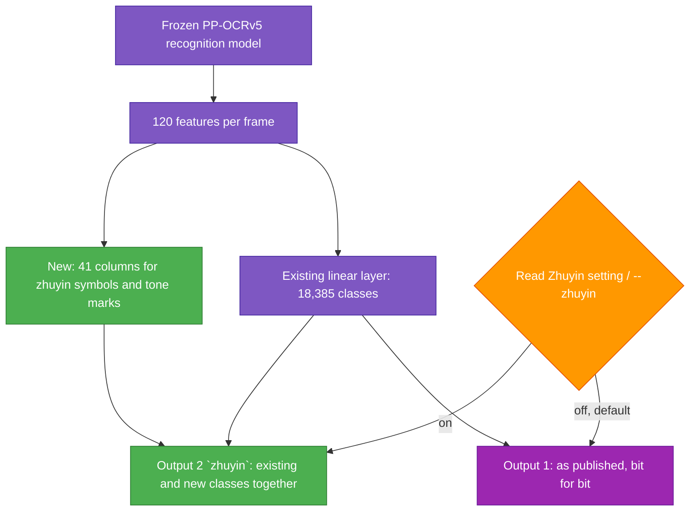

# TASK-002: Zhuyin recognition — progress

Status: **horizontal zhuyin done, behind an experimental option that is off by default.** Vertical zhuyin and search by pronunciation are open, see "Not done".

## Full initial request (verbatim)

> Maybe we can train model to recognize zhuyin later?

> Commit done. Seems correct, proceed till 1.6, then create plan for training on Zhuyin

From TASK-001: "Zhuyin doesn't matter. But could be cool."

## User decisions (2026-10-02)

| Topic | Decision (user's words) |
|---|---|
| Ruby text | "What is ruby text? Maybe sure." → character search across ruby text is wanted |
| Horizontal or vertical | "Doesn't matter, should work both ways. Zhuyin characters should be searchable in many ways." |
| Hardware | "I would like to NOT rent a GPU. Ideally free notebook tier should be enough. Maybe even on CPU? As the model is small and we may not have as many examples in Zhuyin. But we should generate some." |
| Model hosting | "They should be hosted in the repo if possible and not too big and licenses allow." |
| Other languages | "Make sure it does not break accuracy in other languages." |
| Toggle | "And maybe add experimental toggle in settings to use the zhuyin trained model, otherwise use default." |
| Own handwriting | "My handwriting was terrible, not sure if you really want to train on it lol" → it is used for testing only |

## What was built

- **No retraining, no GPU.** The model ends in one linear layer. Only 41 new columns are learned, on rendered lines, on this laptop's CPU: about an hour to render the lines, 2 minutes to train and test. Script, command, fonts and full results: [`misc/zhuyin/README.md`](../../misc/zhuyin/README.md).
- **Default untouched.** The model file gets a second output; the first one equals the published model exactly (largest difference on real lines: 0.0).
- **Option, off by default.** `rnote-cli index --zhuyin`, and "Read Zhuyin (experimental)" in the app settings (GSettings key `search-zhuyin`). The index remembers per file whether zhuyin was read; switching the option makes a file be read again the next time it is indexed.
- **Search ignores tone marks**, and a query without zhuyin also matches across zhuyin symbols in a line.
- Checked in the running app: the setting row (`tmp/ui_setting_zhuyin.png`); a file indexed with the setting off is read again with zhuyin after the setting is switched on and the file saved.
- **Index version.** `Index::VERSION` (now 2); an index of another version is emptied and fills again.

## Results

Chosen settings: 2 epochs, margin 1.0. Fonts and sentences not trained on:

| | Before | With zhuyin on |
|---|---|---|
| Zhuyin lines: character error rate | 72.5% | 11.0% |
| Zhuyin symbols read as first reading | 0% | 92.3% |
| Zhuyin symbols among the kept readings | 0% | 98.0% |
| Other languages, 32,671 characters: first reading becomes zhuyin | – | 122 (0.37%) |
| … old reading not kept either, so not findable | – | 6 (0.02%) |

Real material, not trained on:

| | Before | With zhuyin on |
|---|---|---|
| The user's 42 handwritten symbols (7 practice rows): right as first reading | 0 | 38 |
| … among the kept readings | 0 | 42 |
| 187 real lines (printed Chinese and English, English handwriting) read differently | – | 7 |

The 7: five are lines with ruby zhuyin where junk characters became zhuyin symbols; two are handwritten English lines (a leading `-` became `ㄧ`, a `&` in an already misread word became `ㄆ`). No printed Chinese or English line changed.

Whole sample (`sample_docs/New Document.rnote`, 131 units), indexed once in each mode:

| | Default | Zhuyin on |
|---|---|---|
| Lines identical to the index made before any zhuyin work, including all candidates | 3,121 of 3,121 | – |
| Lines | 3,121 | 3,198 (77 more: symbols that were not read at all before) |
| Lines read differently from default | – | 1,287, nearly all of them lines with printed zhuyin or ruby zhuyin; the textbook is full of both |
| Hits for `ㄋㄋㄋ` / `ㄖ` / `ㄙ, ㄛ` | 0 / 0 / 0 | 4 / 41 / 3 |
| Hits for `注音符號` / `學生` / `the` / `student` / `vivacious` | 6 / 11 / 205 / 30 / 2 | the same |
| Hits for `老師` / `念念看`, which sit in ruby text | 2 / 6 | 5 / 7 |
| Time, peak memory | 155 s, 818 MB | 162 s, 816 MB |

Printed exercise lines now read `Circle ㄋ，ㄌ and ㄏ in the picture below.` where they read `Circle 3， and 厂 …` before. Ruby zhuyin comes out as one zhuyin symbol after most characters (`老ㄌ師ㄕ`); a query without zhuyin is matched with those symbols left out, which is why ruby text finds more with zhuyin on. Side effects seen on handwriting: a few Latin letters inside words became symbols (`MAMA←TETiS` → `MAMAㄑㄒEㄒiS`).

**On "does not break accuracy in other languages":** with the option off, nothing changes at all. With it on, about 0.4% of ordinary characters in unfamiliar fonts get a zhuyin symbol as first reading (typically `T`→`ㄒ`, `c`→`ㄈ`, `n`→`ㄇ`, `Y`→`ㄚ`); the original stays as a second reading in all but 0.02%, so search still finds it.

**Caveat:** the settings were picked while looking at these same test sets, so the numbers are optimistic, and the real sets are small.

## What was learned on the way

| Attempt | Outcome |
|---|---|
| Per-frame linear columns, also firing in the middle of glyphs the model reads nothing for | Stray symbols inserted into ordinary text: 52 of 187 real lines changed |
| Same, without that rule | 14–31 of 187 changed, specific characters taken over (`使`→`ㄑ`, `國`→`ㄖ`) |
| Plus lines that run through the whole dictionary | 7 of 187, all but two in ruby lines |
| A head that looks at neighbouring frames | No better on real lines, dropped |
| Training for 8 epochs instead of 2 | Larger weights, fires more on unseen fonts; 22 instead of 38 handwritten symbols right |
| Large margin instead of better training text | Protects other text but loses handwritten symbols fast (margin 4: 29 of 42) |

The loss question (why it stops falling after a few epochs): the problem is small and convex, so it is solved quickly; of a final loss of 0.32 in that run, 0.11 was a floor the frozen model leaves on frames that keep their class, the rest real confusion between symbols and look-alikes.

## Not done

- **Vertical zhuyin and ruby zhuyin** ("should work both ways"): not read. The model reads a line frame by frame from left to right; a vertical stack shares its frames. A possible route: cut tall line boxes, turn them by 90°, and train a second set of columns on turned symbols. Not tried.
- **Ruby text and character search**: solved only with zhuyin on, where ruby turns into zhuyin symbols that a character query skips. Where a ruby symbol is still read as some other junk character (`林号東氢明`), and in default mode, a multi-character query across ruby text still fails. The plan's general gap-tolerant search (2.0) is not implemented.
- **"Searchable in many ways"**: only tone-insensitive matching is done. Not done: pinyin queries converted to zhuyin, and finding characters by their reading.
- **Handwritten training data**: none; only fonts.
- TASK-003 (text from PDFs at import) would give the textbook's ruby zhuyin exactly, if the PDF carries it.

## Subtasks

| ID | Description | Status |
|----|-------------|--------|
| 2.0 | Gap-tolerant search for ruby text | Partly: character queries skip zhuyin symbols; no general gap tolerance |
| 2.1 | Test sets from real pages | Done: 42 handwritten symbols, 187 real lines (`tmp/zhuyin/real`, `tmp/zhuyin/real_other`, not in the repository) |
| 2.2 | Training data | Done, rendered by the script |
| 2.3 | Train | Done, as new output columns instead of a fine-tune |
| 2.4 | Model file | Done, written directly as ONNX; first output verified unchanged |
| 2.5 | App: option, index version, tone-insensitive match | Done |
| 2.6 | Vertical zhuyin | Not started |

## Log

- 2026-10-02: checked the model's last layer (`MatMul` with `linear_8.w_0` [120, 18385], `Add`, `Softmax`). The frozen model maps each zhuyin symbol to a consistent look-alike, so its features tell the symbols apart.
- 2026-10-02: first runs: 40 of 42 handwritten symbols right, but 58 of 187 real lines changed. Found and removed the blank-frame rule, added dictionary-sweep lines, tried a neighbour-aware head, a margin, weight decay and epochs (see table above).
- 2026-10-02: final model written with `misc/zhuyin/train_head.py` and put into `crates/rnote-ocr/models/` (recognition model 16,651,597 bytes, 20 KB larger; `zhuyin_dict.txt`). Recogniser, CLI option, index and app setting wired up.
