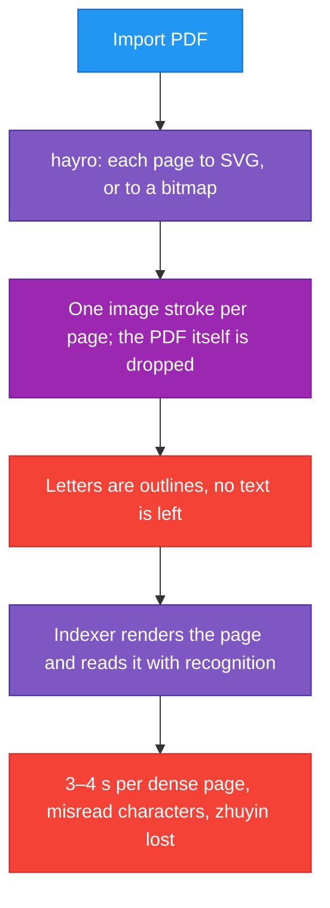
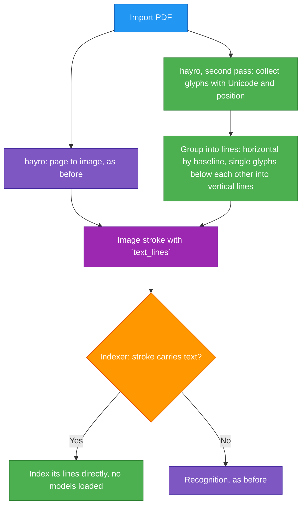

# TASK-003: Import the text of PDFs — progress

Status: **done.** The user's textbook PDF turned out to have no text at all, so it gains nothing from this; see "The textbook".

## Full initial request (verbatim)

> If we import PDF, can we also import text|?

> Create task file for it, we'll do it next.

> Now do task 003

## Overview

When a PDF is imported, the text it carries is kept with each page, and search indexes that text exactly instead of reading the page image back with recognition.

## Flow

Previous flow:

New flow:

## What was built

Chosen solution: the plan's initial one, text stored on the image stroke inside the `.rnote` file.

| File | Change |
|---|---|
| `crates/rnote-engine/src/strokes/imagetext.rs` (new) | `ImageTextLine`, `pdf_page_text`: a `hayro_interpret::Device` that takes down glyphs, and the grouping into lines |
| `crates/rnote-engine/src/strokes/vectorimage.rs`, `bitmapimage.rs` | Optional `text_lines` field, filled by `from_pdf_bytes` |
| `crates/rnote-engine/src/strokes/stroke.rs` | `Stroke::text_lines()`: the text a stroke carries, on the document. Typed text and image text go through it |
| `crates/rnote-cli/src/index.rs` | A unit whose strokes carry text is indexed from it, recognition only runs for the rest |
| `crates/rnote-cli/src/import.rs`, `cli.rs` | `rnote-cli import` also takes a `.pdf`. Needed to test the chain without the UI |
| `crates/rnote-engine/examples/pdf_text.rs` (new) | Prints the lines that would be kept for each page of a PDF |
| `misc/file-tests/text.pdf` (new) | 640-byte fixture for the engine test |

Details that matter:

- **Positions are fractions of the page.** Each line stores its text, the left and right edge of every character, and top and bottom, all as shares of the image's width and height. They are mapped through the stroke's rectangle when needed, so a page that is moved, scaled or rotated takes its text along.
- **Lines are formed by position, not drawing order.** Glyphs on one baseline and of one size make a line; a gap wider than 2 font sizes splits it (columns); a gap wider than 0.2 font sizes becomes a space. This keeps a line of characters whole when ruby is drawn in between them.
- **Vertical lines.** Single glyphs right below each other in the same column are joined top to bottom. That is how ruby zhuyin is set, so a ruby syllable comes out as one line (`ㄨㄛˇ`) and is found by a zhuyin query. A tone mark that sits beside the stack instead of in it stays on its own.
- **Invisible text counts**, which is how scanned PDFs with a recognised text layer carry it.
- **Left out:** text that does not run left to right (rotated, vertical writing mode), glyphs without a Unicode value, private-use and control characters, and glyphs of Type 3 fonts (drawn with PDF instructions, no advance width to place them by).
- **No change to `rnote-ocr` or the app.** Lines are lines; search and highlight work as before.

## Results

Test PDF made here (`tmp/pdf/test_zh.pdf`: Traditional Chinese, English, zhuyin, two columns, characters with ruby zhuyin):

| | |
|---|---|
| Lines kept at import | 13, all texts exact, including `ㄋㄧˇ ㄏㄠˇ ㄇㄚ˙` |
| Two columns on one baseline | two lines |
| Characters with ruby in between | one line `我 是 李 大 文`; each ruby stack its own line `ㄨㄛˇ`, `ㄕˋ`, `ㄌㄧˇ`, `ㄉㄚˋ`, `ㄨㄣˊ` |
| Text in the saved file | 4.4 KB of JSON for the page, next to 142 KB of SVG |
| Indexing the note | 0.13 s, 36 MB peak; the models are not loaded |
| Searches `學習華語`, `老師`, `quick brown`, `右邊`, `李大文`, `ㄏㄠ`, `ㄅㄆㄇ`, `ㄨㄛ` | each finds its line |
| Hit positions | drawn over the rendered page: on the right characters, the ruby stack included (`tmp/pdf/highlights.png`) |

Other checks:

| Check | Result |
|---|---|
| Collector on a 314-page LaTeX manual (`/usr/share/doc/hwloc/hwloc-a4.pdf`) | 14,528 lines in 0.98 s, 13 MB. The second pass at import costs next to nothing |
| Vector and bitmap import of the fixture | both carry `Hello World` and `second line`, placed where the page is on the document (engine test) |
| A page without a text layer (image-only PDF) | no lines kept; indexing reads it with recognition as before and the text is found |
| Existing `.rnote` files | load as before (`rnote-cli test misc/file-tests/*.rnote`) |
| Tests | `rnote-engine` 7 (4 new), `rnote-ocr` 8 |
| Format and lint | `cargo fmt --check` clean; clippy clean on `rnote`, `rnote-cli`, `rnote-engine`, `rnote-ocr` |

## The textbook

`sample_docs/001.學華語向前走課本-入門A-注音符號版.pdf` (112 pages, made with Adobe InDesign): the collector finds 0 lines on every page. Confirmed with poppler: `pdffonts` lists no fonts and `pdftotext` gives nothing. All text was converted to outlines when the PDF was made. For this book recognition stays the only way; importing it took 48 s and indexing it with recognition 160 s (112 units).

## Not checked, and limits

- **The app's import dialog** was not driven. It calls the same engine functions as `rnote-cli import`.
- **Upstream rnote opening such a file.** The stroke types do not reject unknown fields (no `deny_unknown_fields` anywhere in the workspace), so the extra field should be ignored. Not run against an upstream build.
- Notes imported before this change keep using recognition: the PDF is gone and there is nothing to collect from.
- A page with a text layer is indexed from it alone. Words inside pictures on such a page are not found. A scan with only a small text layer (a watermark, a page number) would be indexed from that alone.
- Reading order across columns is not reconstructed; lines are independent, which is all search needs.
- hayro calls its Unicode lookup "still somewhat experimental".

## Subtasks

| ID | Description | Status |
|----|-------------|--------|
| 3.1 | Spike: print the text lines hayro gives for pages of a real PDF | Done on a made test PDF, a LaTeX manual and the textbook (which has no text) |
| 3.2 | Engine: collect and group at import, store on the image strokes | Done |
| 3.3 | Engine and CLI: index image text, skip recognition for it | Done |
| 3.4 | Check on a real import: hits, highlight position | Done for position. A moved and resized page is covered by the mapping test; a rotated page is not tested |

## Log

- 2026-10-02: the user added the textbook PDF: no text layer, see above. Text that a document carries is now also searched live in the open document, without the index (see TASK-001 log).
- 2026-10-02: plan written.
- 2026-10-02: implemented and checked as above. Added vertical lines after seeing ruby stacks come out as single symbols. Added PDF input to `rnote-cli import` to be able to test without the UI.
