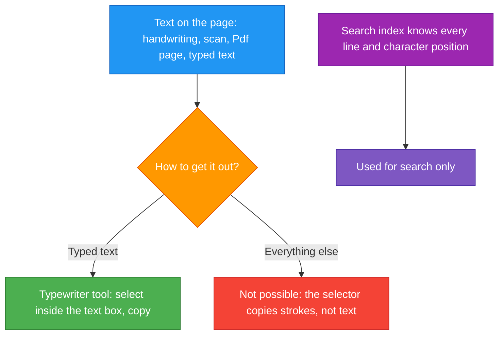
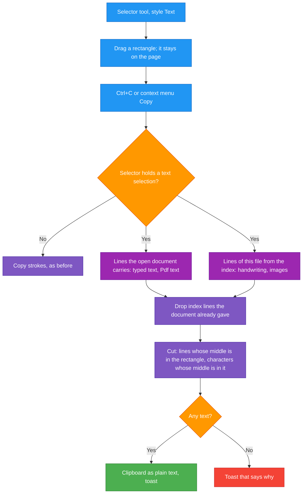

# TASK-004: Select and copy text — progress

Status: **implemented and checked in the running app (2026-10-04).** Builds; `cargo fmt --all --check`, both clippy runs and the tests (16 in `rnote-ocr`, 7 in `rnote-engine`) are clean. Not committed. What was done and how it differs from the plan: see "Result" at the end.

## Full initial request (verbatim)

> Ok nice, it has no text it means then, no? Either way, after we do OCR and stuff, can we also make text selectable, copyable?

> Do small, but lines may be cut, like ABC\nDEF but person could select BC\nEF only. create progress doc

> Or maybe text selection mode would be more elegant near the bottom tools..?

> A and do the doc and not implement yet

("A" = a new style of the existing Selector tool, not a seventh tool in the bottom bar.)

> Create self sustaining task doc, with how to test UI, I will start a new session for implementation

> Let it know it can just check previous session

## Read first

- `rnote_ocr_search.md` in the repo root: the project rules. The ones that bite: never `git stash`, never run `git commit` (print a `Suggested commit` block, no Co-Authored-By or any AI attribution), temporary files only in `./tmp/`, KISS, structs over tuples, UI reuses existing components and theme variables, screenshots for UI changes, update this file as work goes on and print its full path at the end of the message.
- `crates/rnote-ocr/README.md`: how recognition, the index and search work.
- `docs/tasks/task_001_progress.md` and `task_003_pdf_text_import_progress.md`: what exists.
- The previous session, for anything this file leaves open: `/home/minip/.claude/projects/-home-minip-projects-rnote/25889df2-83fb-44b8-8c65-a4fbc1835f65.jsonl`. It is 19 MB, search it with `grep`, do not read it whole.

## Overview

A fifth style of the Selector tool, "Text": drag a rectangle over the page, press Ctrl+C (or right click → Copy), and the text inside the rectangle is on the clipboard. Lines are cut at the rectangle's edges: over

```
ABC
DEF
```

a rectangle that covers only the right two columns copies `BC\nEF`.

## Flow

Previous flow:



New flow:



## What already exists

Everything is in document coordinates, so a rectangle drawn on the canvas can be compared with it directly.

| Thing | Where | Note |
|---|---|---|
| `Line { bounds: Bounds{x,y,w,h}, chars: Vec<CharBox> }`, `CharBox { x0, x1, candidates }`, `CharBox::top()`, `CharBox::exact(ch, x0, x1)`, `Line::text()` | `crates/rnote-ocr/src/lib.rs` | A character has only a left and right edge; top and bottom are the line's |
| Index tables `files(path, …)`, `units(file_id, hash, page, source)`, `lines(unit_id, x, y, w, h, text, chars)` | `crates/rnote-ocr/src/index.rs:47` | `chars` is the JSON of `Vec<CharBox>`. `Index::search` at `:212` shows how rows become `Line`s. Paths are stored canonical and absolute |
| Text a stroke carries, with exact character boxes | `Stroke::text_lines()`, `crates/rnote-engine/src/strokes/stroke.rs:217` | Typed text and the text layer of imported Pdf pages |
| Building `Line`s from the open document | `document_results`, `crates/rnote-ui/src/workspacebrowser/search.rs:219` | Loops `engine.extract_text_units(SplitOrder::default())` → strokes → `text_lines()`. Reuse, do not copy |
| Dropping index hits the document already gave | `merge_results`, same file `:272` | Same path and bounds within 1.0 |
| Selector styles | `crates/rnote-engine/src/pens/pensconfig/selectorconfig.rs` | `Polygon`, `Rectangle`, `Single`, `IntersectingPath`; serde names, and numbers through `TryFrom<u32>` |
| Selector state and drawing | `crates/rnote-engine/src/pens/selector/mod.rs`: `SelectorState` `:65`, `update_state` `:111`, `fetch_clipboard_content` `:160`, `bounds_on_doc` `:277`, `draw_on_doc` `:310`, `add_to_select_path` `:485` | |
| Selector events | `crates/rnote-engine/src/pens/selector/penevents.rs`: down `:20`, up `:406`, proximity `:540`, key `:575`, text `:715`, cancel `:745` | All `match` on state and style without a catch-all: the compiler lists every place a new variant needs an arm |
| Style buttons | `crates/rnote-ui/data/ui/penssidebar/selectorpage.ui`, `crates/rnote-ui/src/penssidebar/selectorpage.rs` (`selector_style` `:75`, `set_selector_style` `:90`, toggles from `:105`) | A linked box of four `GtkToggleButton`s in one group |
| Copy action | `win.clipboard-copy`, `crates/rnote-ui/src/appwindow/actions.rs:1074`, `<Ctrl>c` at `:1224` | The context menu's Copy (`data/ui/contextmenu.ui`) is the same action |
| Toasts | `appwindow.overlays().dispatch_toast_text(text, None)`, `crates/rnote-ui/src/overlays.rs:467` | |
| Icons | `crates/rnote-ui/data/icons/scalable/actions/pen-selector-*-symbolic.svg` | A new icon has to be listed in `crates/rnote-ui/data/meson.build` (near `:226`) and `data/resources.gresource.xml` (near `:97`) |

The engine does not depend on `rnote-ocr` and must not start to. The engine only knows the rectangle; the app puts the text together.

## Plan

### Cutting rule (`rnote-ocr`, pure and unit tested)

New module `crates/rnote-ocr/src/select.rs` (add to `lib.rs` and to `crates/rnote-ocr/src/meson.build`):

```rust
/// The text of the lines inside the area, cut at its edges.
pub fn text_in(lines: &[Line], area: Bounds) -> String
```

- A line takes part when its vertical middle is inside the area.
- Of such a line, the characters whose horizontal middle is inside the area are taken, each as `CharBox::top()`. A line with none left is dropped.
- Lines are ordered top to bottom and joined with `\n`. Lines on one row (vertical middles closer than half the smaller height) are ordered left to right and joined with a space: two columns, and the pieces a recogniser splits a row into.
- Each cut line is trimmed; no trailing newline.

Tests to write first: the `ABC`/`DEF` → `BC\nEF` case from the request; a rectangle around everything; one that touches nothing; a rectangle covering half of a line's height from above (in) and a sliver of it (out); two lines on one row; lines given in the wrong order.

### Lines of one file from the index

`Index::lines(&self, path: &Path) -> anyhow::Result<Vec<Line>>` in `index.rs`: the `SELECT` of `search` with `WHERE files.path = ?1`. One test. If `search` and `lines` end up building `Line` from a row twice, give them one helper.

### Engine: the Text style

1. `SelectorStyle::Text`, `#[serde(rename = "text")]`, **appended last** so the numbers of the others stay.
2. `SelectorState::TextSelection { bounds: Aabb }`.
3. While dragging, Text behaves like Rectangle: same arm in `add_to_select_path` and in `draw_on_doc` (`SelectorStyle::Rectangle | SelectorStyle::Text`).
4. Pen up with style Text (`penevents.rs:422`): no strokes are selected; the state becomes `TextSelection` with the rectangle, progress `InProgress`. A rectangle with no size goes back to `Idle`. Mind that this arm ends by calling `self.update_state`, which sets the state from the stroke selection.
5. `TextSelection` otherwise: pen down starts a new `Selecting` like `Idle` does; Escape and cancel go to `Idle`; `draw_on_doc` and `bounds_on_doc` show the rectangle (same colours, solid outline is enough to tell it from dragging).
6. `update_state` (`mod.rs:111`) is called by the engine after undo, redo, loading and more (`engine/mod.rs:364–408`, `:765–811`). Decide what it does with a `TextSelection`: keeping it when no strokes are selected is the least surprising. Check that it survives from pen up until Ctrl+C.
7. `Engine::text_selection(&self) -> Option<Aabb>` for the app. `PenHolder::current_pen_ref` takes `&mut self` for no reason visible; add a `&self` path rather than borrowing mutably for a read.
8. `fetch_clipboard_content` and `cut_clipboard_content` already return nothing unless the state is `ModifySelection`; Ctrl+X on a text selection must stay a no-op.

### App

1. Move the part of `document_results` that turns the document into `Line`s into its own function next to it, returning a struct with the page and the line (not a tuple), and use it from both search and copy.
2. `selectorpage.ui` / `.rs`: a fifth toggle in the same group, tooltip "Select Text to Copy", wired like the other four in `init`, `selector_style` and `set_selector_style`. Icon `pen-selector-text-symbolic.svg` in the style of the other four (16 px symbolic; a dashed rectangle with a "T" or text lines in it), registered in both lists.
3. `win.clipboard-copy`: before the existing code, if `canvas.engine_ref().text_selection()` gives a rectangle:
   - lines of the open document (function from step 1);
   - lines of the file from the index, when the document has a file: `blocking::unblock(move || Index::open()?.lines(&path))`, path canonicalised as in `document_results`;
   - drop index lines that the document already gave (the rule of `merge_results`; share it);
   - `rnote_ocr::select::text_in(&lines, area)`;
   - text found: `appwindow.clipboard().set_text(&text)` and a toast such as "Text copied"; none: a toast, "No text here. Handwriting and images can be copied once the document is saved." when the document has no file or the indexer is busy (`crate::indexer::is_busy()`), else "No text in the selection".
4. All new strings through `gettext`.

### Docs

One line in the root `README.md` section "Text Search (this fork)", a short "Copying text" part in `crates/rnote-ocr/README.md`, and this file.

## Subtasks

| ID | Description | Status |
|----|-------------|--------|
| 4.1 | `rnote-ocr`: `select::text_in` with tests | Done |
| 4.2 | `rnote-ocr`: `Index::lines` with test | Done |
| 4.3 | Engine: `SelectorStyle::Text`, `SelectorState::TextSelection`, `Engine::text_selection` | Done |
| 4.4 | App: style button and icon | Done |
| 4.5 | App: copy action puts document and index lines together, toasts | Done |
| 4.6 | Check in the running app on typed text, Pdf text and the recognised textbook; screenshots in `./tmp/` | Done |
| 4.7 | READMEs, this file | Done |

Not in this task, possible next: marking the exact characters that will be copied instead of showing only the rectangle (the app would hand the cut boxes to the engine, the way `Engine::set_search_highlights` works); dragging across words like in a text editor.

## Known limits to state, not to solve

- Handwriting and images give text only after the document was saved and indexed, and the index holds positions as of the last save. Strokes moved since then are found at their old place until the next save.
- Recognised text is as good as the recognition: the top candidate of each character is copied.
- Text that does not run left to right in an upright box (rotated typed text, rotated pages) is cut by its bounding box only.
- Reading order across columns is by row, not by column.

## Building and checking

The machine has 4 cores and 7.7 GB of RAM and has killed parallel builds several times. Build with one job.

```bash
cd /home/minip/projects/rnote
export CARGO_HOME=$PWD/_mesonbuild/cargo-home
T="--manifest-path Cargo.toml --target-dir _mesonbuild/target"

cargo build -j 1 $T -p rnote          # the app, about 2.5 min after a UI change
cargo build -j 1 $T -p rnote-cli
cargo test  -j 1 $T -p rnote-ocr      # 8 tests today
cargo test  -j 1 $T -p rnote-engine --lib   # 7 tests today
cargo fmt --all --check
cargo clippy -j 1 $T -p rnote -p rnote-cli
cargo clippy -j 1 $T -p rnote-engine -p rnote-ocr --all-targets --features rnote-ocr/recognize
```

`just fmt-check` fails only on vendored `meson.build` files and `just lint` only on the missing `yamllint`; the cargo commands above are what they run for Rust. A `.ui` or icon change is picked up by `cargo build` (the resources are compiled by the build script); the GSettings schema is not touched by this task.

## How to test the UI

The app is driven from the terminal with three helpers in `misc/ui-testing/` (checked on 2026-10-02):

| Helper | Does |
|---|---|
| `run_ui.sh [FILE.rnote …]` | Starts `_mesonbuild/target/debug/rnote` with settings in memory (defaults, the user's are untouched), its own data dir (`tmp/ui-test/data`, or `UI_TEST_DATA=<dir>`), on the X11 backend, accessibility on. Log: `tmp/ui-test/log/ui_run.log` |
| `atspi.py dump` / `click ROLE NAME` / `type ROLE NAME TEXT` / `state ROLE NAME` | Lists widgets, presses buttons and toggles, fills entries, reads showing/focused/checked. `NAME` is the accessible name, for icon buttons the tooltip |
| `shot.sh OUT.png` | Captures the app's window with ImageMagick `import` |

A session:

```bash
(nohup misc/ui-testing/run_ui.sh tmp/pdf/test_zh.rnote >/dev/null 2>&1 &); sleep 10
A="python3 misc/ui-testing/atspi.py"
$A click button Maximize
$A dump | less                                  # find roles and names
$A click "toggle button" "Selector"             # check the real name in the dump
$A click "toggle button" "Select Text to Copy"
# make the app draw again before capturing, the capture can lag one frame behind:
$A click "toggle button" "Focus Mode"; sleep 2; $A click "toggle button" "Focus Mode"; sleep 3
misc/ui-testing/shot.sh tmp/ui_text_select.png  # then look at the image with the Read tool
kill $(pgrep -x rnote)
```

Things that cost time before:

- **No keys, no pointer on the canvas.** The desktop is Wayland; `xdotool`, `ydotool`, `wtype` are not installed and AT-SPI cannot press keys or drag. Dragging a rectangle and pressing Ctrl+C cannot be done from the terminal. Use a **temporary hook** in the code, as the last session did for activating a search result: for example read `RNOTE_TEST_TEXT_SELECT="x,y,w,h"` (document coordinates) once the file is loaded, put the selector into `TextSelection` with it, activate `win.clipboard-copy`, and `debug!` the copied text so it can be read from the log. Keep a clean copy of each touched file in `tmp/` first, and remove the hook before the final build, format and lint run. `grep -rn RNOTE_TEST crates/` must be empty at the end.
- **Reading the clipboard.** The app runs through XWayland; whether `wl-paste` sees what it copied was not tried. The log line of the hook is the reliable check; `wl-paste` is a bonus.
- **Rectangles to test with** come from the index, which stores the line boxes:
  ```bash
  python3 -c "
  import sqlite3
  c = sqlite3.connect('file:tmp/xdg_book/rnote/ocr/index.sqlite?mode=ro', uri=True)
  for r in c.execute('select page, x, y, w, h, text from lines join units on units.id = unit_id order by page, y limit 20'): print(r)"
  ```
- **Killing.** `kill $(pgrep -x rnote)`. `pkill -f` / `pgrep -f` match the shell running them.
- **Screenshots are large.** Scale them down or crop before reading them (the last session used GdkPixbuf in Python for both).
- **Memory.** Do not build while the app has the textbook open.

Test documents (in `tmp/`, not in git; if they are gone, make them again):

| Document | Has | Data dir | Make again |
|---|---|---|---|
| `tmp/pdf/test_zh.rnote` | Pdf text layer: Chinese, English, zhuyin, two columns, ruby | any | `rnote-cli create tmp/pdf/test_zh.rnote && rnote-cli import tmp/pdf/test_zh.rnote -i tmp/pdf/test_zh.pdf` |
| `tmp/book.rnote` | The textbook, 112 pages, text only through recognition | `UI_TEST_DATA=tmp/xdg_book` | `rnote-cli create tmp/book.rnote && rnote-cli import tmp/book.rnote -i "sample_docs/001.學華語向前走課本-入門A-注音符號版.pdf"` (48 s), then `XDG_DATA_HOME=$PWD/tmp/xdg_book rnote-cli index tmp/book.rnote` (160 s) |
| `sample_docs/New Document.rnote` | The user's handwriting and typed text | index it into a data dir of its own | |

`rnote-cli` is `_mesonbuild/target/debug/rnote-cli`.

What to show at the end (4.6): the rectangle on the page with the style button active; the copied text for (a) a rectangle cutting two Pdf-text lines in `test_zh.rnote` so that the `BC\nEF` behaviour is seen on real text, (b) a rectangle on a textbook page, (c) an unsaved new document with typed text, (d) an empty area, with its toast; Ctrl+C with the other four styles still copying strokes.

## Log

- 2026-10-02: plan written after the user chose a Selector style over a tool of its own. UI test helpers put into `misc/ui-testing/` and run once (start, maximise, search entry focus, typing, switch state, capture).
- 2026-10-04: implemented 4.1 to 4.7, see "Result".

## Result

### Where things are

| What | Where |
|---|---|
| Cutting rule, 7 tests | `crates/rnote-ocr/src/select.rs` |
| `Index::lines`, with `LINE_COLUMNS` / `line_of` shared with `search`, 1 test | `crates/rnote-ocr/src/index.rs` |
| `SelectorStyle::Text` (last, number 4) | `crates/rnote-engine/src/pens/pensconfig/selectorconfig.rs` |
| `SelectorState::TextSelection`, drawing, `Selector::text_selection` | `crates/rnote-engine/src/pens/selector/mod.rs`, `penevents.rs` |
| `Engine::text_selection`; `PenHolder::current_pen_ref` now takes `&self` | `crates/rnote-engine/src/engine/mod.rs`, `pens/penholder.rs` |
| `DocumentLine`, `document_lines`, `index_path`, `same_place`, `copy_text` | `crates/rnote-ui/src/doctext.rs` (new) |
| Search uses `doctext` for the document's lines and the duplicate rule | `crates/rnote-ui/src/workspacebrowser/search.rs` |
| Copy and cut actions | `crates/rnote-ui/src/appwindow/actions.rs` |
| Fifth toggle, icon `pen-selector-text-symbolic.svg` | `selectorpage.ui`, `selectorpage.rs`, `data/meson.build`, `data/resources.gresource.xml` |

### Differences from the plan

- The shared functions went into a module of their own (`doctext.rs`) instead of staying in `search.rs`: the copy action is not part of the workspace browser.
- Three toasts for "no text" instead of two: indexer busy ("No text here yet. Notes are still being read in the background."), document never saved ("No text here. Handwriting and images can be copied once the document is saved."), else "No text in the selection". The plan's single message told the user to save a document that was saved already.
- Toasts use `TEXT_TOAST_TIMEOUT_DEFAULT` like the other text toasts. `None`, as the plan had it, never goes away.
- Ctrl+X on a text selection: the cut action returns early. Without that it emptied the clipboard, as it does (upstream behaviour, left alone) when nothing is selected at all.
- `update_state` keeps a text selection for as long as no strokes are selected, so it survives undo and redo. Escape, pen cancel (which a tab switch or pen change sends) and a new drag drop it.
- When no text is found the clipboard is left as it was.

### Checked in the app

Driven through a temporary command-file hook (removed, `grep -rn RNOTE_TEST crates/` is empty) that sent real pen events and activated `win.clipboard-copy` / `win.clipboard-cut`, the clipboard read back afterwards.

| Case | Rectangle (x y w h) | On the clipboard |
|---|---|---|
| Pdf text, two lines cut, `tmp/pdf/test_zh.rnote`, file also in the index | 130 112 130 52 | `，他是老師。我\nbrown fox jumps` (no line twice) |
| Two columns | 50 260 450 30 | `左邊的欄位 left column 右邊的欄位 right column` |
| Ruby zhuyin above characters | 50 300 240 70 | `ㄨㄛˇ ㄕˋ ㄌㄧˇ ㄉㄚˋ ㄨㄣˊ\n我 是 李 大 文` |
| Recognised textbook, `tmp/book.rnote` | 150 4960 180 45 | `係以語言溝通模式著手，目的在使\n系統，並提供『注音符號』版與『` |
| Same, English | 200 5762 200 40 | `en based on the concepts of communicativ\nhe child to learn the phonetic symbo` |
| Typed `ABC` / `DEF` in an unsaved document | around both lines | `ABC\nDEF` |
| Same text, left edge of the rectangle inside the first column | | `BC\nDEF`: in the proportional font the middle of `D` is right of the middle of `A`, so `D` stayed in. The exact `BC\nEF` case is the unit test |
| Handwriting, `sample_docs/New Document.rnote` | 60 8185 300 100 | `幺\n2 am di Dav\nX ァク？` (as good as the recognition) |
| Empty area, unsaved document | 300 400 100 50 | unchanged, toast "No text here. Handwriting and images can be copied once the document is saved." |
| Undo with a text selection | | selection stays |
| Escape | | selection gone |
| Styles Single, Polygon, Intersecting Path, then copy | | `application/rnote-stroke-content`, `image/svg+xml`, `image/png` as before |

Not run in the app: the early return of the cut action (added after the last run; before it, cut kept the selection and emptied the clipboard), and Rectangle style with a stroke inside (the only stroke of the test document was larger than the rectangle; the code path is unchanged).

Screenshots: `tmp/ui_text_select_pdf.png` (style button active, rectangle over two lines), `tmp/ui_text_select_book.png` (textbook, "Text copied" toast fading), `tmp/ui_text_select_unsaved.png` (toast for an unsaved document), `tmp/ui_text_select_empty.png` (rectangle on an empty area).

### Notes for testing later

- A test hook must drag a rectangle with two points only (corner, opposite corner). `add_to_select_path` keeps the first and the one-before-last point, so going around four corners ends with a rectangle without width.
- Keys pressed on the desktop land in the app under test when its window has the focus (Enter on the focused "New Tab" button opened dozens of tabs in one run). A hook should address the first tab, not the active one.
- `atspi.py state` reports `checked: False` for an active toggle button; look at the screenshot instead.
