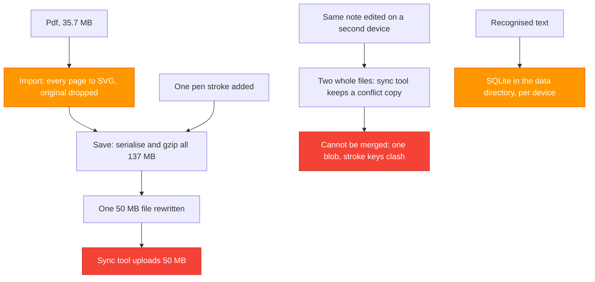
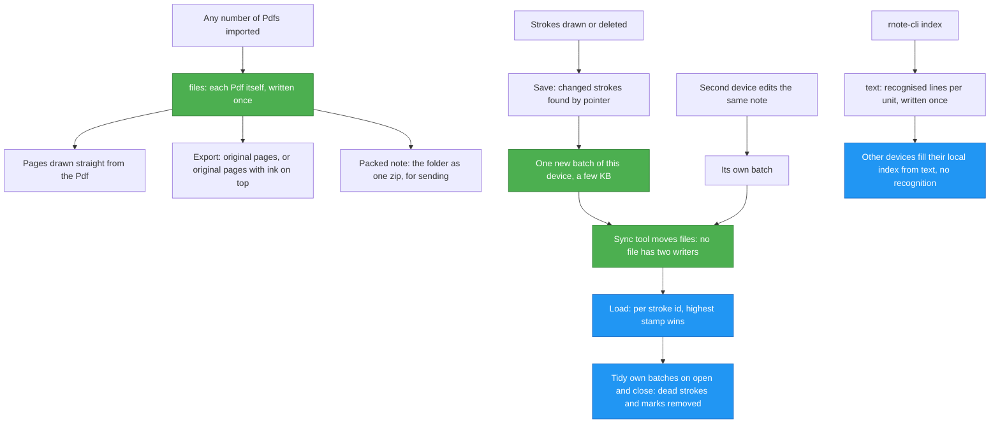
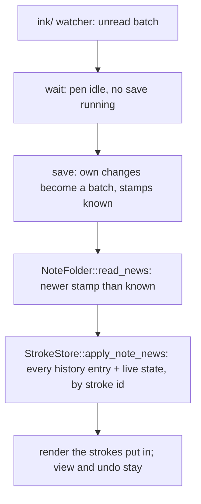

# TASK-005: Notes library, sync and a sync-friendly note format — progress

Status: **Done (2026-10-12).** Phase 1 (library) and phase 2 (note format) are built and checked, including the five items that were left: pictures as original files, merging another device's batches without a reload, tidy on close, the Windows installer (untried, no Windows here) and the "Performance" settings. Also new: test hooks in dev builds (`crates/rnote-ui/src/testhooks.rs`, `crates/rnote-ui/README.md`). `cargo fmt --all --check`, both clippy runs and the tests (44 in `rnote-engine`, 19 in `rnote-ocr`) are clean. What was done on the last day is in "The rest, finished (2026-10-12)".

## Full initial request (verbatim)

> We want to have sync via google drive and similar. How it should work: Notes folder that would sync etc. Like current workspace, but parent workspace of all. Like goodnotes. Then you'd be able to search in folders/spaces etc. Think of an elegant way to do this, create progress file in docs/tasks/ please. Offer some ways to do things. Don't implement yet.

> 1. Doesn't matter; 2. Maybe yes, idk. What would be most elegant? 3. Sure; 4. Yes ofc. We don't want to lose any functionality. Just to have global notes place or something. And yes, all indexes etc. should be put to the same dir somehow to sync. And it would ideally allow for partial updates or resolving conflicts somehow. We don't want to resync whole 300MB file with every little change and save. Could we do a new format too for that? Or multiple files or something?

> Oh, I like the little files for strokes. Also, we should maybe batch the strokes. And if deleted, delete the strokes file/modify or something. Conflicts sounds good maybe. Just we don't want to keep empty "strokes" that were deleted. Synced index - yes. Single-file - yes. Just maybe a new format. Like rnote2 or rnoter or something to differentiate. Wdyt? 2. Yes, sure. 3. On demand; 4. Outside tool for now. Also, can we leave PDF unmodified if we import as vector? Or must we convert? I'd love to be able to take it out if this new file format could provide that. Maybe some other improvements could be put into this file.

> Also we should be able to have folders inside folders or something

> Why do we need the conversion when importing PDFs?  Is it really necessary? Also, we should be able to import as many PDFs as we want. And export regions (select PDF and take out original or with notes on top or something). First lets figure this out

> And maybe full exported file should just be gzipped dir? Or something like that? So that sharing wouldn't lose anything. And would have a different extension

> Maybe converting once per device into a local cache is a not a terrible choice. This could be a toggle in performance settings. Cache could be either limited size or something; 2. folder .rnoted for each "note". 3. .rnotez sounds ok. 4. Huh? Both options. 5. Sure. Another thing: Can we do new format that would be used to open the notes that would be just a thin entrance point into the folder? Or what?

> Or maybe the .rnoted works?

> 1. Do cache on; 2. It is fine

> Proceed

> Good, continue now to phase 2, I just commited.

## Read first

- `rnote_ocr_search.md` in the repo root: the project rules (never `git stash`, never run `git commit`, temporary files only in `./tmp/`, KISS, structs over tuples, reuse existing UI components and theme variables, no backwards compatibility).
- `crates/rnote-ocr/README.md` and `docs/tasks/task_001_progress.md`: how recognition, the index and search work.

## Overview

1. **Library**: one "Notes" folder as the global place, with folders inside folders. Workspaces stay as they are. Search can be narrowed to the document, the shown folder, or everything.
2. **Note format**: a note becomes a folder of files. A save writes only what changed, an imported Pdf is kept as the original file and uploaded once, recognised text travels with the note, and two devices never write the same file, so a sync tool has nothing to conflict on.
3. **Sync**: an outside tool moves the files. With part 2 any of them is safe.

## User decisions (precise wording)

| Topic | Decision (user's words) |
|---|---|
| Devices | "Doesn't matter" → the design must not depend on one sync tool or system |
| Library model | "**We don't want to lose any functionality.** Just to have global notes place or something." → workspaces stay, the library is added above them |
| Folders | "we should be able to have **folders inside folders** or something" |
| Index | "all indexes etc. should be put to the same dir somehow to sync" / "Synced index - yes" |
| Notes outside the library | "Yes ofc" → still openable and indexed |
| Partial updates | "We don't want to resync whole 300MB file with every little change and save." |
| Format | "I like the little files for strokes." → a note folder with per-device change files |
| Batching | "we should maybe **batch the strokes**" |
| Deleted strokes | "if deleted, delete the strokes file/modify or something" / "we don't want to keep **empty 'strokes' that were deleted**" |
| Conflicts | "Conflicts sounds good maybe." → highest stamp per stroke wins |
| Single file | "Single-file - yes." → `.rnote` stays for opening, "Save as" and sending |
| Name | "Just maybe a new format. Like rnote2 or rnoter or something to differentiate." / own ending: "Yes, sure" |
| Existing files | "On demand" |
| Sync tool | "Outside tool for now." |
| Pdf | "can we leave PDF unmodified if we import as vector? … I'd love to be able to take it out" |
| Conversion | "Why do we need the conversion when importing PDFs? Is it really necessary?" → it is not, see "Pdfs" |
| Many Pdfs | "we should be able to import **as many PDFs as we want**" |
| Export | "export regions (select PDF and **take out original or with notes on top** or something)" |
| Sharing | "full exported file should just be **gzipped dir**? Or something like that? So that sharing wouldn't lose anything. And would have a **different extension**" |
| More | "Maybe some other improvements could be put into this file." |
| Pdf drawing | "converting once per device into a local cache is a not a terrible choice. This could be **a toggle in performance settings**. Cache could be either **limited size** or something" |
| Note folder | "folder **.rnoted** for each 'note'" |
| Packed file | "**.rnotez** sounds ok" → a zip |
| Original pages of several Pdfs | "**Both options**" → one file per Pdf, or one combined file, chosen in the export dialog |
| Pictures as original files | "Sure" |
| Entry | "Can we do new format that would be used to open the notes that would be just a **thin entrance point into the folder**?" / "Or maybe the .rnoted works?" → an entry file `note.rnoted` in the folder, same ending, no further format; "It is fine" |
| Pdf setting starts as | "Do **cache on**" |

## Decisions needed

None. What is still open are things to find out while building, see "Open points".

## Current analysis

What exists (all verified in the code):

- **Workspaces** are a flat list of unrelated folders, each with a name, icon and colour, stored in GSettings (`workspace-list`; `workspacesbar/workspacelistentry.rs`). The browser shows one directory at a time through a monitored `gtk4::DirectoryList` and already goes into subfolders and back up (`workspacebrowser/mod.rs:68`).
- **A note is one file**: the whole `EngineSnapshot` (document, camera, all strokes, their order) as JSON, gzipped (`engine/snapshot.rs`, `fileformats/rnoteformat`). Every save, and every autosave, serialises, compresses and rewrites all of it (`canvas/imexport.rs:221`).
- **A Pdf is converted at import** and the original is thrown away. In vector mode every page becomes an SVG string (`hayro_svg::convert`, `strokes/vectorimage.rs:214`), in bitmap mode raw pixels. Pictures are stored as raw pixels too (`image.rs:74`), not as the PNG or JPEG they came from.
- **Strokes are identified by slot** (`StrokeKey` of a `SlotMap`). Two devices that each add a stroke give it the same key, so two versions of a note cannot be merged by key.
- **The store is copy-on-write**: strokes are `Arc<Stroke>`, changed through `Arc::make_mut` (`store/`). Comparing pointers against the last saved state tells which strokes changed.
- **The index** is one SQLite file in `~/.local/share/rnote/ocr/index.sqlite`, files keyed by absolute path, text stored per unit, a unit keyed by a hash of its content (`rnote-ocr/src/index.rs`, `engine/export.rs:341`).
- **Indexing** only happens for a file the app loads or saves (`indexer::queue` → `rnote-cli index <file>`). `rnote-cli index` already takes folders and skips unchanged files.
- **The open file is watched** (`canvas/mod.rs:1085`): a change from outside gives the "reload?" toast.

Measured on `sample_docs/` (a 112 page Pdf with 500 pen strokes on it):

| | Size |
|---|---|
| The Pdf as it was imported | 35.7 MB |
| The note on disk (gzip) | 49.9 MB |
| The note uncompressed | 137.0 MB |
| of that: the 112 pages as SVG | 134.5 MB (98 %) |
| of that: 500 pen strokes | 2.7 MB (2 %), 5 KB for a typical stroke |
| Importing the Pdf (`rnote-cli import`, development build) | 56 s, about half a second a page |

One more pen stroke is 5 KB of new data and a 50 MB upload. The converted pages are larger than the Pdf they came from.

Drawing one page at twice its size, 14 pages spread over the book, development build (throwaway example, deleted again):

| | Median | Average | Range |
|---|---|---|---|
| Straight from the Pdf (`hayro::render`) | 261 ms | 558 ms | 14 ms – 1.8 s |
| Convert the page to SVG (`hayro_svg::convert`), once | 208 ms | 347 ms | 6 ms – 1.3 s |
| Draw the converted SVG (`rsvg`), as the canvas does today | 119 ms | — | 19 ms – 0.6 s, and **one page took 79 s** |



## Part 1: the library

Workspaces stay exactly what they are: a named, coloured shortcut to a folder, anywhere on disk. Nothing is removed. Added:

- One setting `library-dir`: the Notes folder, chosen in Settings → General → "Notes Library". Without one the app is as before.
- The library is the first, pinned entry of the workspaces bar ("Notes", library icon). It cannot be removed, edited or moved; it is not saved with the workspaces but made from the setting. A click on it always shows the library folder itself, wherever opening folders has taken it.
- **Folders inside folders**, to any depth. The library is a plain folder tree and the browser already walks it; a workspace can point at a folder of any depth. A note folder (Part 2) is shown as a note and is never entered.
- A note outside the library opens, saves and is indexed as today.

```
Notes/                           <- library-dir
├── Mandarin/
│   ├── Book A/
│   │   ├── Unit 1/
│   │   │   └── Lesson 1.rnoted  <- a note (Part 2)
│   │   └── Vocabulary.rnoted
│   └── Old lesson.rnote         <- a single-file note, works as before
└── Work/
```

### Search scopes

- `Index::search` takes a scope: a file, or a folder whose files at any depth are searched. Filtered in SQL.
- A scope selector under the search entry, shown while searching: **Document · Folder · All Notes** (`adw::ToggleGroup`). "All Notes" is what search did before. The choice is remembered (`search-scope`).
- "Folder" is the folder the files list shows. With the library entry selected that is the whole library.
- The subtitle of a result shows where the note is, below the library or else below the shown folder: `Mandarin / Book A / Unit 1 / Lesson 1 · Page 2`.
- Index paths stay absolute and canonical; a scope is a path prefix.

### Library scanner

- At start, and whenever a note below the library changes on disk, the library is indexed through the existing `indexer` queue (`rnote-cli index <library>`, which skips unchanged files and drops missing ones).
- Changes are seen by one recursive watcher on the library (`notify_debouncer_full`), after three quiet seconds, so that a sync that brings fifty files gives one run.
- This makes notes from another device searchable without opening them.

### Phase 1: differences from the plan

- **Three scopes, not four.** The plan had "Folder" and "Workspace". They are the same thing: opening a folder in the browser changes the folder of the selected workspace (`appwindow/mod.rs`, `FileType::Folder`), so the workspace is always the shown folder.
- **Workspace entries are not synced; there is no `.rnote-library.json`.** For the same reason: an entry's folder is where the user last went, so a synced entry would move on every device whenever someone opens a folder on one of them, and the file would be rewritten on every click. Syncing them needs entries with a fixed folder apart from the shown one, which changes how workspaces work. Left out until the user asks for it; workspaces stay in GSettings, per device.
- The library is chosen in the settings, not at first start. Nothing is created or asked for unprompted.

## Part 2: the note format

### The rule

Every file in a note folder is one of two kinds, and neither can conflict:

- **Named by its content** (`files/`, `text/`): written once, never changed. If two devices write the same name, the content is the same.
- **Named by its device** (`ink/`): only that device ever writes, rewrites or deletes it. A device id is a random id made once per installation.

```
Lesson 1.rnoted/
├── note.rnoted                   the way in: a tiny file that opens the note; written once
├── files/
│   ├── 9f2c…e1.pdf               an imported Pdf, exactly as it was
│   └── 31aa…07.png               an imported picture, exactly as it was
├── ink/
│   ├── a1b2c3d4-000017.jsonl.gz  a batch of changes saved by device a1b2c3d4
│   └── 77e0f9aa-000003.jsonl.gz  a batch of changes saved by device 77e0f9aa
└── text/
    └── 5d01…7b.2.json            recognised lines of one unit; named by unit hash and model version
```

### The way in: an entry file

The note is the folder, and a folder cannot be double-clicked open or picked in a file dialog. So every note folder holds one tiny file, `note.rnoted`, that stands for the note:

- It holds the format version and nothing else. It is written when the note is made and never again, so it follows the rule above.
- The ending `.rnoted` is registered for Rnote next to `.rnote` (`data/app.mimetype.xml.in`, the desktop file, the Windows installer). A double click on the file opens the note; so does picking it in the file dialog, dropping it on the window, or passing it to `rnote` and `rnote-cli`. Rnote opens the folder the file is in. A path to the folder itself is taken the same way.
- File managers show it with the Rnote icon and, through the existing thumbnailer, with a picture of the first page.
- In Rnote's own browser none of this shows: a note folder is one row, like a file.

Why the entry file is inside the folder and not a small file beside it: beside it, a note would be two things that have to be moved, renamed and deleted together, and whoever moves only the small file has a note that opens empty. Inside, the folder is the whole note for the file manager, the sync tool and the zip. The entry file also must not hold content such as the ink: it would be the one file every device writes, and conflicts would be back.

What stays as it is: in a file manager the note is still a folder to step into before the entry file can be clicked. Only macOS can show such a folder as one item; that is set up where the macOS app is packaged, which is not in this repository.

### Batches of strokes

A file in `ink/` is a batch: all strokes that changed since the last save, not one file per stroke. It is gzipped, and a line is one record:

```json
{"subject": {"stroke": 4710478254430455214}, "stamp": {"counter": 41, "device": "a1b2c3d4"}, "hash": 1234, "content": {"stroke": {"chrono": {…}, "stroke": {…}}}}
```

- `subject` is what the record is about: a stroke by its id, `"document"` (format, background, layout), or `{"camera": "<device>"}` (the view, one per device). No file is shared between devices.
- `content` is the stroke as it is serialised today with its place in the drawing order, or `"removed"`. A page of a Pdf will hold the name of the Pdf in `files/` and its page number in place of the page data.
- `hash` is a fixed hash (FNV-1a) of the content. A device tells by it that a stroke it loaded did not change, without comparing the strokes.
- `stamp.counter` is one more than the highest counter the device has seen in this note. It needs no clocks.
- The id of a stroke is a random number that the stroke gets when it is made (`ChronoComponent::id`). It is saved in single-file notes too.

**Load.** Read all batches, and for every id keep the record with the highest stamp (ties go to the device id). That is the whole merge. It gives the same result on every device, in whatever order the files arrived.

**Save.** Compare the strokes with the last saved state: by pointer where the stroke was saved before in this session, else by hash. Write the changed ones as one new batch. For the sample note, one more pen stroke is one new file of a few KB. Nothing else is touched, so an autosave costs what was drawn since the last one.

### Deleted strokes do not stay

Deleting a stroke writes a small removal mark in the next batch: the id and a stamp, no stroke. The mark only exists so that other devices learn of the delete. It is cleaned away by tidying.

**Tidying** runs when a note is opened or closed, never during an autosave. A device tidies only its own batches:

1. Own records that are beaten by a higher stamp anywhere are dead. A stroke this device wrote and somebody deleted is such a record.
2. An own removal mark is dead once no batch holds that stroke any more: none of another device, and none of this device after this tidying.
3. A small batch (under 256 KB) is written again without its dead records as soon as it has any. A larger one only when more than a quarter of it is dead, so deleting one stroke does not cause a 1 MB upload; until then the dead stroke and its mark both stay in place. More than 16 small batches are put together into batches of about 1 MB. A batch with nothing left is deleted.

The new batches are written first and the old ones deleted after, so an interrupted tidying leaves records twice, never missing. Nothing is tidied while a batch in the folder cannot be read (a sync tool is still writing it).

What that gives:

| Case | After tidying |
|---|---|
| Stroke drawn and deleted on the same device | Stroke and mark are both gone, in one step |
| Stroke drawn on A, deleted on B | B writes a mark. A syncs and drops the stroke. B syncs and drops the mark. Nothing is left. |
| A device is offline | Marks for its strokes wait until it has synced and tidied |
| A device is never used again | Its batches and the marks for them stay. "Clean up note" writes the whole note as fresh batches of this device and deletes the rest; to be used when all devices are in sync. `rnote-cli convert` does the same. |

One limit, accepted: when a stroke is deleted on A and, before learning of it, changed on a device that stays offline until after A and the others have tidied, the stroke comes back with that change. An edit made without knowing of the delete wins. Nothing is lost by it.

### What a conflict becomes

| Two devices, offline, same note | Result |
|---|---|
| Both add strokes | All strokes are there |
| One erases a stroke, the other adds elsewhere | Both happen |
| Both move or recolour the same stroke | The later save wins for that stroke |
| One erases a stroke, the other changes it | The later save wins |
| Both change the page background | The later save wins |

**The open note.** When batches of another device arrive while the note is open: save first if there are unsaved changes (that only adds an own batch, so it can never destroy anything), then load again and keep the view where it was. No question to the user.

### Pdfs

#### Why there is a conversion today, and whether it is needed

It is not needed. It is there because of how Rnote grew:

- On screen a "vector" page is never drawn as vectors. The stored SVG is turned into pixels at the current zoom by `rsvg`, again after every zoom (`VectorImage::gen_images` → `Svg::gen_image`, `strokes/vectorimage.rs:84`). "Vector" only means "sharp at every zoom because it is drawn again".
- The engine has one kind of stroke for that, the SVG image. A Pdf page was made to fit it by converting it at import.
- The Pdf library that does the converting (`hayro`) can also draw a page to pixels itself, at any size. The bitmap import already uses that (`hayro::render`, `strokes/bitmapimage.rs:201`).

So a page stroke can hold "this Pdf, this page" and be drawn from the Pdf directly. The measurements above say what that costs and gains:

| | D1: straight from the Pdf | D2: Pdf kept, converted once per device into a cache |
|---|---|---|
| Import | Copy the file, read the page texts. No conversion. | Same, conversion in the background |
| First open on another device | At once | Converts in the background, about 40 s of work for the sample |
| Drawing a page after a zoom | Median 261 ms, at worst 1.8 s | Median 119 ms, but one sampled page took 79 s |
| Memory | The Pdf (35.7 MB) | The SVG of every page (137 MB), as today |
| Disk beside the note | Nothing | A cache of about 1.2 MB a page |
| Moving parts | One source, no cache | A cache to fill, find and throw away |

Decided: **both, as one setting.** The note is the same either way: it holds the Pdf, never converted pages. The setting only picks the route from Pdf to pixels on this device.

- A new group "Performance" in the settings panel, with "Pdf pages": **Converted and cached** (the default) or **Straight from the Pdf**, and the size limit of the cache.
- Cached: a page is converted the first time it is drawn and stored in the cache directory (`~/.cache/rnote/pages/`, named by Pdf hash and page number), outside the library. Later draws read it from there. The SVG is not kept in memory between draws, so memory stays low in both settings.
- The cache has a size limit (first guess 1 GB). When it is over, the pages that were not drawn for the longest time are deleted. A deleted page is simply converted again when it is next drawn. The whole cache can be thrown away at any time.
- Switching the setting takes effect at the next draw; nothing in any note changes.

The numbers are from a development build and from one book. The trial in the app on the sample, zooming on the slow pages, shows how both routes feel before the rest is built on them.

The choice between "vector" and "bitmap" at import means nothing any more for a note folder: both are the same page stroke.

#### In the note

- The Pdf is copied into `files/` unmodified, named by the hash of its content. The page stroke holds that name, the page number, where the page sits on the canvas, and the text of the page (as today, for search and copy).
- **As many Pdfs as wanted.** `files/` holds any number, and each page knows its Pdf. The same Pdf imported twice is stored once. What is in memory is the Pdf files, not their converted pages.
- A Pdf with a password stays encrypted in the note; the password is asked for when the note is opened.
- A Pdf of which only some pages are still in the note is kept whole. It is removed from `files/` by "Clean up note" when no page refers to it.
- A single-file `.rnote` cannot hold a Pdf. There a Pdf is converted at import as today, and "Save as `.rnote`" of a note folder converts its pages at that moment.

#### Export: original, or with notes on top

Select pages with the selector, or nothing for the whole document, then export as Pdf. One switch: **Original** or **With notes on top**.

| What | How | Result |
|---|---|---|
| Original, a whole Pdf | Copy of the file in `files/` | Byte for byte the file that was imported, under its old name |
| Original, some pages | The pages are lifted out of the Pdf into a new one, not drawn again (`hayro-write`, `extract_pages_to_pdf`) | A smaller Pdf with those pages as they were |
| Original, pages of several Pdfs | A choice in the dialog: **one file per Pdf**, or **one combined file** with the pages in the order they have on the canvas | As chosen |
| With notes on top | The original page is placed in the new Pdf as it is. The ink over it is drawn by the existing export code into a see-through layer, which is placed on top (`hayro-write` + `pdf-writer`). All ink over the selected pages is taken, selected or not. | The text of the Pdf stays real text that can be selected and searched; the file is about the size of the original plus the ink |

Today's Pdf export draws the converted SVG through cairo, so pages come out re-drawn. The whole-document export moves to the same new path.

To be checked first, in a small trial before the export is built: `hayro-write` is in the hayro repository at the revision the project already pins, but it is not a dependency yet and its README calls it an internal crate, and `extract_pages_to_pdf` a test helper. What survives lifting a page out (links, form fields, bookmarks) has to be looked at on real files. Export to SVG keeps working by converting the exported pages at that moment.

### The packed file for sharing

"Export → Packed note" writes the note folder as one zip file with its own ending (`.rnotez`). Nothing is lost: the original Pdfs and pictures, all ink, and the recognised text are in it, so the receiver can search at once.

- A zip, not a tar.gz: a single file can be read out of it without unpacking the rest, files that are already compressed (Pdf, JPEG, the batches) are stored as they are, and every system can open it to take the Pdf out by hand.
- The note is tidied before packing, so the file holds no deleted strokes.
- Opening a `.rnotez` unpacks it as a note folder, into the library by default, and opens that. Editing inside the packed file is not planned: every save would write the whole file again.
- The three endings, each with one job: `.rnoted` the note folder that syncs · `.rnotez` the same thing packed, for sending · `.rnote` the old single file, kept for existing notes and for other Rnote versions, with Pdfs converted.
- Needs a zip crate; none is in the dependency tree yet.

### Recognised text

`rnote-cli index` writes the lines of a unit to `text/` after recognising it, and reads from there before recognising. The name carries the unit hash, the model version and the zhuyin flag, so a file is never rewritten. A second device finds the text there and only fills its local SQLite file, which stays outside the library as a cache: sync tools corrupt databases. Text of units that no longer exist is deleted when a file is indexed, as `Index::finish_file` does for rows today. The unit hash is `DefaultHasher` now, which Rust does not promise to keep stable between versions; it becomes a fixed algorithm.

### Other improvements the format makes possible

| Improvement | In this task? |
|---|---|
| **Saving costs what changed.** Today every autosave serialises and compresses the whole note. | Yes, it is the format |
| **Search and copy-text work at once on a new device**, from `text/`. | Yes, it is the format |
| **Pictures kept as the PNG or JPEG they came from**, not as raw pixels, which are many times larger. Same mechanism as the Pdf. | Recommended: yes |
| **Less memory**: the Pdf instead of the SVG of every page (35.7 MB instead of 137 MB for the sample). | Yes, with D1 |
| **Pdf export that keeps the original pages**: real text, small file. | Yes, see "Export" |
| **One file for sending that loses nothing.** | Yes, see "The packed file" |
| **Covers in the browser**, like GoodNotes: a small picture of the first page, kept in the device's cache. | Later |
| **Tags, favourites, a title apart from the file name**: new fields in the document record, no format change needed. | Later |

### What changes around it

- Engine: a stroke id that is unique across devices (new component next to `ChronoComponent`), reading and writing a note folder, a fixed unit hash, a new stroke kind for a Pdf page that is drawn from the Pdf, Pdf export that places original pages. The SVG image stroke stays for SVG files and for old notes.
- UI: `output_file` can be a note folder. The browser shows a note folder as a note row. Rename, duplicate and trash act on the folder. The open-file watcher watches `ink/`. New: the Original / With notes switch in the export dialogs, "Export → Packed note", "Clean up note", "Convert to synced note".
- CLI: `index`, `export`, `thumbnail` accept note folders; `rnote-cli convert` between the formats, `pack` and `unpack`.
- **The single file `.rnote` stays** for opening and "Save as". Existing `.rnote` files are converted on demand, never by themselves. A converted note has no original Pdf (it was dropped at import); its pages stay SVG image strokes, with the SVG as files in `files/`.

### Costs to know

- A note is a folder in file managers and in the Drive web page. It is opened through its entry file, see "The way in".
- A half-synced note can refer to a Pdf that has not arrived. Its pages are shown empty and filled in when the file is there.
- Pdf pages: with the cache, the first draw of each page on a device includes its conversion, and the cache takes about 1.2 MB a page on disk; without it, every draw of a typical page takes about twice as long as today.
- Two new dependencies: `hayro-write` with `pdf-writer` for the export, and a zip crate for the packed file.
- It is the largest piece of work in this task and it touches saving, which must not lose data. The merge and tidy rules get tests in `rnote-engine` before any UI.

### Not chosen

- **Only moving imported pages out of the file:** fixes the upload size, does nothing for conflicts.
- **One hidden store for the whole library:** notes that break when copied out, and unsafe clean-up while a device is offline.
- **A CRDT library (automerge, loro, yrs):** strokes are whole things that are added, replaced or removed; "highest stamp per id" is the complete answer for that.
- **One file laid out so that only parts change:** Google Drive and rclone upload whole files.
- **The SQLite index in the synced folder:** gets corrupted.

## New flow



## Part 3: who moves the files

Decided: an outside tool for now. The library sits inside a folder that a sync client handles (Google Drive for desktop, Dropbox, OneDrive, Nextcloud, Syncthing; on Linux rclone or Insync for Google Drive). The app does nothing over the network.

Kept for later, if the app should sync by itself: running `rclone bisync` the way the app runs `rnote-cli` (about 70 providers, little code), or a Google Drive client inside the app (one-button sign-in, most code, one provider, Google's review). Rejected: GNOME Online Accounts / gvfs mount of Google Drive (Linux only, slow, files appear under opaque ids).

## Implementation plan

Phase 1, library:

1. `Index::search` with a scope; test in `rnote-ocr`. `rnote-cli search --in <folder>`.
2. Scope selector and result paths in `workspacebrowser/search.rs`.
3. `library-dir` setting with its row in the settings, pinned library entry in the workspaces bar.
4. Library watcher and scan at start in `library.rs`, through the `indexer` queue.

Phase 2, note format (state in "Phase 2: progress"):

1. Two trials before anything is built on them: a Pdf page stroke drawn both ways, tried in the app on the sample; lifting pages out and placing ink on top with `hayro-write`, looked at on real files.
2. Engine: stroke ids, records, batches, load (merge), save (changed strokes), tidy, the entry file. Tests for every row of the conflict table and of the delete table.
3. Engine: `files/`, the Pdf page stroke with both drawing routes, the page cache with its limit, original picture files.
4. Engine: Pdf export, original and with notes on top.
5. `rnote-cli`: note folders in `index`, `export`, `thumbnail`; `convert`, `pack`, `unpack`.
6. Fixed unit hash, `text/` files, index filled from them.
7. UI: open and save note folders, browser rows, file row actions, watcher with save-then-reload, export switch, packed note, the two note actions, the "Performance" settings group.
8. Registration of `.rnoted` and `.rnotez`: mime types, desktop file, thumbnailer, Windows installer.

## Phase 2: progress

| # | Step | State |
|---|---|---|
| 1a | Trial: lifting pages out of a Pdf and placing ink on top (`hayro-write`) | Done, works |
| 1b | Trial: a Pdf page drawn both ways in the app | Moved to step 3: it needs the user's eyes on zooming, the numbers are in "Current analysis" |
| 2 | Engine: stroke ids, records, batches, load (merge), save (changed strokes), tidy, entry file; 22 tests | Done |
| 5 | `rnote-cli`: `convert`, `pack`, `unpack`, `pdf-pages`; note folders in `index`, `search`, `export`, `thumbnail`, `test`, `import` | Done |
| 5b | Packed notes (`.rnotez`): engine, cli, "Export Packed Note", opening one unpacks it; 1 test | Done |
| 7 | App: open, save, Save As, browser rows, library watcher, merge of what other devices wrote while the note is open, "Performance" group | Done |
| 3a | `files/`: the original Pdf, page records without page data, page cache with limit; 6 tests | Done |
| 3b | Pictures as original files; drawing straight from the Pdf and the "Performance" group (route, cache size) | Done |
| 4 | Pdf export, original and with notes on top: engine, `rnote-cli pdf-pages`, two entries in the app's export menu; 5 tests | Done |
| 6 | Device-independent unit hash, `text/` files written and read by `rnote-cli index`; 3 tests | Done |
| 8 | Registration of `.rnoted` and `.rnotez`: mime types, desktop file, thumbnailer, Windows installer | Done; Linux not installed and tried, Windows not tried |

A Pdf that is imported into a document is kept in memory as it was (`Engine::files`) and written into `files/` when the document is saved as a note folder. Its pages are then saved as "this Pdf, this page", without what is drawn of them. A page whose Pdf is not at hand (a note converted from a `.rnote` file, a Pdf with a password) is saved whole, as in a single-file note.

### Trial: `hayro-write`

`crates/rnote-engine/examples/pdf_pages.rs` (kept, it is the pattern for step 4): `cargo run -p rnote-engine --example pdf_pages -- <file.pdf> <out-dir> <page>...` writes `original_pages.pdf` and `with_ink.pdf`.

| Checked | Result |
|---|---|
| Pages 5, 30 and 60 of the 35.7 MB textbook, lifted out | 1.5 MB, 0.7 s, three pages of the right size |
| The same with a stroke and a see-through highlighter bar on top | 2 KB more; drawn right in `pdftoppm` renders (`tmp/t005/pages_book/ink-2.png`) |
| `tmp/pdf/test_zh.pdf`, text of both outputs against the original (`pdftotext`) | Identical; fonts embedded |
| Links, form fields, bookmarks | Not checked, the test files have none |

The public `hayro_write::extract` is used, not the hidden test helpers. New dependencies: `hayro-write` (same repository and revision as `hayro`) and `pdf-writer` 0.14.

### Where things are

| What | Where |
|---|---|
| `NoteFolder`: `create`, `load`, `save`, `has_unread_batches`, `folder_of`; `Device` (id and page cache) | `crates/rnote-engine/src/notefolder/mod.rs` |
| `FileName` (FNV-1a 128 of the content, and the ending), `Files` (imported files held in memory) | `crates/rnote-engine/src/notefolder/files.rs` |
| `PageCache`: `get`, `put`, `trim` to a size, least recently used first | `crates/rnote-engine/src/notefolder/pagecache.rs` |
| `PdfPageRef` on `VectorImage`, the page image as it is saved, `pdf_page_svg_data` | `crates/rnote-engine/src/strokes/vectorimage.rs` |
| `Engine::files`, kept through snapshots; the Pdf is kept at import | `crates/rnote-engine/src/engine/mod.rs`, `snapshot.rs`, `import.rs` |
| `Engine::export_pdf_pages`, `pdf_page_files`, `PdfPagesExport` | `crates/rnote-engine/src/engine/pdfpages.rs` |
| `rnote-cli pdf-pages <note folder> <out.pdf> [--original]` | `crates/rnote-cli/src/pdfpages.rs` |
| "Export Pdf Pages With Notes", "Export Original Pdf Pages"; the question for pages of several Pdfs | `crates/rnote-ui/data/ui/appmenu.ui`, `dialogs/dialogs.ui`, `src/dialogs/export.rs`, `appwindow/actions.rs` |
| `RnCanvas::load_files`: reads the Pdfs from the note folder when an export needs them | `crates/rnote-ui/src/canvas/imexport.rs` |
| `NoteFolder::pack`, `pack_snapshot`, `unpack`; `EngineSnapshot::pdf_files` | `crates/rnote-engine/src/notefolder/pack.rs`, `engine/snapshot.rs` |
| `FileType::PackedNote`, `RnCanvas::load_in_packed_note`, `NoteFolder::load_packed`, "Export Packed Note" | `crates/rnote-ui/src/filetype.rs`, `appwindow/mod.rs`, `dialogs/export.rs`, `data/ui/appmenu.ui` |
| Mime types `application/rnote-folder` (`*.rnoted`, the entry file) and `application/rnote-packed` (`*.rnotez`) | `crates/rnote-ui/data/app.mimetype.xml.in`, `app.desktop.in.in`, `rnote.thumbnailer` |
| `textfiles`: read, write once, retain; `TEXT_VERSION` | `crates/rnote-ocr/src/textfiles.rs` |
| `stable_content_hash` (FNV-1a over the record form of the strokes), used by `TextUnit::content_hash` | `crates/rnote-engine/src/notefolder/record.rs`, `engine/export.rs` |
| Indexing takes text from `text/` before recognising, writes what it recognised, removes the text of units that are gone | `crates/rnote-cli/src/index.rs` |
| Records, stamps, device id, batches, the content hash | `crates/rnote-engine/src/notefolder/record.rs` |
| `NoteFolder::tidy` | `crates/rnote-engine/src/notefolder/tidy.rs` |
| Tests: every row of the conflict and delete tables, and more | `crates/rnote-engine/src/notefolder/tests.rs` |
| `StrokeId` in `ChronoComponent`; strokes with the same `t` ordered by id | `crates/rnote-engine/src/store/chrono_comp.rs` |
| Selection no longer changes the order of strokes it does not change | `crates/rnote-engine/src/store/selection_comp.rs` |
| `convert`, `load_note`, note folders in the other commands | `crates/rnote-cli/src/convert.rs`, `cli.rs`, `index.rs`, `import.rs`, `export.rs`, `thumbnail.rs`, `test.rs`, `validators.rs` |
| `FileType::NoteFolder` | `crates/rnote-ui/src/filetype.rs` |
| Open, save, Save As to a note folder | `crates/rnote-ui/src/canvas/imexport.rs`, `appwindow/mod.rs`, `dialogs/export.rs` |
| Watcher on `ink/`, `merge_note_folder_news` | `crates/rnote-ui/src/canvas/mod.rs` |
| Note folders as note rows | `crates/rnote-ui/src/workspacebrowser/mod.rs` |
| Library watcher sees changes inside note folders | `crates/rnote-ui/src/library.rs` |

The device id is a random 8 character id in `<data dir>/rnote/device-id`, made when first needed, shared by the app and the cli. The page cache is `<cache dir>/rnote/pages/`, one gzipped file per page named by the hash of the Pdf and the page number, trimmed to 1 GB after pages were made.

### How it behaves

- **Save As** decides by the name: one that ends in `.rnoted` gives a note folder, any other a single file. In the library the suggested name ends in `.rnoted`, elsewhere in `.rnote`. Saving an existing `.rnote` note as `.rnoted` is the conversion on demand; `rnote-cli convert` does it without the app.
- **While a note folder is open** its `ink/` directory is watched. When batches of another device appear, the app waits until no stroke is being drawn, saves (which only adds a batch), reads the news and applies them to the open document, and shows "Changes from another device were added". The view, the selection of untouched strokes and the undo history stay (see "The rest, finished").
- **Tidying** runs when a note folder is loaded, when its tab is closed and when the app quits.
- The search index knows a note folder by the path of the folder. Whether it changed is told by its `ink/` directory.
- **A Pdf page whose Pdf has not arrived yet** (a sync tool brought the batches first) is loaded as an empty page that still knows its Pdf and page. It is drawn once the note is loaded again with the Pdf there. Nothing loads it again by itself yet.
- **A Pdf with a password** is not kept: its pages are saved whole.
- **The import dialog** no longer offers "Vector or Bitmap". Every Pdf page is a vector page that knows its page of the Pdf, and a row says that the Pdf is kept with the note and can be exported again (or, for a Pdf with a password, that it is not kept). Bitmap pages had one job, drawing cheaply; that falls to how Pdf pages are drawn (the "Performance" setting, open). The engine and the cli still know bitmap pages.
- **In memory**, with pages converted (the default), what is drawn of every page is held as before. With "Draw Pdf Pages From the Pdf" only the Pdf is held, see "The rest, finished".
- **Taking the Pdf out** is copying it from `files/`, or "Export Original Pdf Pages".
- **Export of Pdf pages** (menu → Export): the selected pages of kept Pdfs, or all when none is selected, in the order they lie on the document (top to bottom, left to right). Every exported page has the size of its Pdf page.
  - "Original": all pages of one Pdf in their order give that Pdf byte for byte; anything else is lifted out page by page, not drawn again. For pages of several Pdfs the app asks: one Pdf, or one for each (the chosen name with ` - 1`, ` - 2`).
  - "With Notes": the page as it is, and on top of it everything that touches the page on the document, drawn where it is on the page, also when the page was moved, resized or turned. Other kept Pdf pages are not notes.
- **Recognised text travels with the note.** `rnote-cli index` writes the lines it recognised from a unit into `<note>/text/<unit hash>.<text version>.json`, once, and reads them from there before recognising. The unit hash is now FNV-1a over the strokes as they are written into records (a Pdf page by its page, not by what is drawn of it), so it is the same on every device; `Index::VERSION` went to 3, which empties the index once and fills it again. Typed text and the text layer of Pdf pages are not written, they are in the records. Text of units the note no longer has is removed when the note is indexed, text of other `TEXT_VERSION`s is left for the devices that run them. The library watcher sees the text files arrive, but a note whose `ink/` did not change is skipped, so that costs a directory walk.
- **A packed note** (menu → Export → "Export Packed Note", or `rnote-cli pack`) is a zip with the note saved anew by this device: one batch, the Pdfs as they were, nothing that was removed. From the app it is the document as it is right now, saved or not. Files in it are stored without compressing them again. **Opening a `.rnotez`** (from the browser, where packed notes are listed with the other files, or as an argument) opens it as a new, unsaved document that carries the name of the packed note, like a file one received: nothing is unpacked anywhere lasting (a temporary folder is used while loading and deleted). Save puts it where the user chooses, with its Pdfs; Save As suggests `<name>.rnoted`, in the library when the browser shows it. The user asked for this instead of unpacking into the library by itself.
- New dependency: `zip` 2.4 (with `zopfli`, which its deflate support brings).
- **Selecting pages:** a selected image (a Pdf page or a picture) is tinted, not only outlined, so that of pages that lie next to each other it is seen which are selected (before, pages 1 and 3 looked like 1 to 3). The context menu of the canvas has "Select All Pages of This Pdf", which extends a selection with one page to every page of that Pdf; with that the export covers a whole Pdf among several. The export dialog says what it takes: "Export the 2 Selected Pdf Pages" or "Export All 112 Pdf Pages". Pages stay separate strokes on purpose: each lies at its own place, can be moved or deleted alone, and ink, search and export work per page.
- Differences from the plan: these are two menu entries, not a switch in the export dialogs. The old name of a Pdf is not kept; the file dialog suggests the name of the note. "Export Document" as Pdf is unchanged and still draws the pages; it puts document pages out, which are not the Pdf's pages unless the import adjusted the document to them.

### Found while testing, and fixed

- **Selecting changed strokes it did not change.** `StrokeStore::set_selected` moved a stroke to the end of the drawing order on every call, also when the stroke was deselected or already in the state asked for. "Deselect all", which runs on every import and tool change, so gave every stroke a new place, and a note folder would have written every stroke again on every save. Now only a stroke that becomes selected moves to the front. This also keeps strokes in the order the user gave them, which a later "deselect all" used to undo.
- The first run of the two-device scenario showed it: the Pdf page was written again by the device that had only imported a picture, and that copy then won over the other device's removal of the page.

### Checked

Engine tests (28 new, 32 in `rnote-engine`): the Pdf is kept byte for byte and its page records hold no page data; the saving device has the page in its cache and another makes it from the Pdf, once; a page without its Pdf stays a page and is drawn once the Pdf is there; a page whose Pdf is not at hand is saved whole; the cache drops what was not used for longest; file names cannot lead out of the directory; load after save; nothing written when nothing changed; each row of the conflict table; each row of the delete table; tidying never touches other devices' batches; small batches are put together; half-written files are left alone and stop tidying; the id survives a single-file note.

`rnote-cli` on `sample_docs/New Document.rnote` (612 strokes, 112 Pdf pages):

| Case | Result |
|---|---|
| `convert` to a note folder | 4.8 s, one batch of 49.9 MB |
| `convert` back to `.rnote` | 4.5 s; same 612 strokes, same document and view. Differences are the ones any save makes: strokes written in today's form, and 11 leftover order entries of removed strokes gone |
| `index` of a small note folder, twice | Indexed once, skipped the second time |
| `search --in`, `export doc` | Find and export from the note folder |

The 35.7 MB textbook, 112 pages, imported into a note folder with `rnote-cli import` (`tmp/t005/book/`):

| Case | Result |
|---|---|
| The note folder | 35 MB: the Pdf, byte-identical to the original (`cmp`), and 5.6 KB of batches. The single-file note of the same is 49.6 MB |
| Import | 77 s (56 s into a single file): the pages are also put into the page cache |
| Page cache of the device | 71 MB, 112 files |
| Load on the device that imported | 0.6 s |
| First load on a second device, empty cache | 39 s, then 0.6 s |
| `convert` to `.rnote` | 4 s, 49.6 MB |
| Opened in the app | Window shows the note after about 2 s, pages drawn (`tmp/t005/shot_9_c.png`), 559 MB of memory |
| Save in the app | One batch of 153 bytes: the view of the device. No page is written again |

The first load on a new device blocks the opening of that note for as long as the pages take, with the usual progress bar. Making them in the background, the pages in view first, is not built.

Pdf export:

| Case | Result |
|---|---|
| Engine tests | All pages of a Pdf give the Pdf itself; selected pages come out in document order; pages of two Pdfs come as one Pdf or as their own; with notes the text is still text, the page keeps its size, and the stroke is dark at its place in a rendering of the page and nowhere near it in the original |
| `rnote-cli pdf-pages --original` on the textbook note | 1.3 s, byte-identical to the imported Pdf |
| `rnote-cli pdf-pages` (with notes) on it | 5.7 s, 112 pages, 34.6 MB (the Pdf is 35.7 MB) |
| From the app, a picture laid over page 1 | 112 pages, 34.7 MB; page 1 rendered shows the page with the picture where it is in the app, cut at the page edge (`tmp/t005/book/ui_notes-001.png`, app: `tmp/t005/shot_10_c.png`) |
| From the app, original | Byte-identical |

Recognised text with the note (`tmp/t005/text/Scan.rnoted`, a scanned page):

| Case | Result |
|---|---|
| Device A indexes | 1.4 s, "1 changed unit(s) read, 0 taken from the note", `text/3f1cf66a6540a584.1.json` written |
| Device B (own data dir) indexes the same folder | 0.18 s, "0 changed unit(s) read, 1 taken from the note"; search finds the line; both indexes hold the same line at the same place |
| Tests | Text is kept once and read back, a half-written file is not read; the text of units that are gone is removed, text of another version and nothing else stays; the hash of a Pdf page unit is the same whatever is drawn of it and differs for another page or a page without its Pdf |

Packed notes:

| Case | Result |
|---|---|
| Engine test | A note changed by two devices, with a removed stroke and a Pdf: the packed and unpacked note has the strokes, the Pdf byte for byte and its page, one batch, and no trace of the removed stroke. An existing folder is not unpacked into; a file that is no zip is refused |
| `rnote-cli pack` of the textbook note | 1.3 s, 35.7 MB: the Pdf, one batch of 5 KB, the entry file |
| `rnote-cli unpack` | 0.06 s; the Pdf is byte-identical; the note loads |
| The app started with the `.rnotez` | Opens as "Textbook", subtitle "Draft", tab marked unsaved; nothing written next to the file; closing asks about the unsaved document |
| The app started with `Unpacked.rnoted/note.rnoted` | Opens the note "Unpacked" |

Not run: "Export Packed Note" from the menu (file dialog; `pack_snapshot` behind it is what the engine test and the cli run). The new mime types are not installed on this machine, so a double click in a file manager was not tried.

Found on the way: lifting each page out on its own doubled the size (76 MB), because what pages share was copied for each. All pages of a Pdf are now lifted out in one go. Not run: the menu entries and dialogs themselves (file dialogs); the export behind them was run through the hook.

In the app, with the cli as second device (`tmp/t005/scenario.sh`; rows and files opened through a temporary command-file hook, removed):

| Case | Result |
|---|---|
| Note folder in the browser | One row with the note icon, not a folder |
| Open it | Title is the folder name without ending |
| Import a picture, Save | One new batch of the app's device with the picture and the view; the Pdf page of the other device is not written again |
| Save again | Nothing written |
| Second device removes the page and the picture and adds a page, while the app has an unsaved second picture | Within 8 s and without a click: the app's picture is saved, the note is loaded again and holds the new page and the second picture; the removed ones are gone; the app's own dead record is tidied away |
| Save once more | Nothing written |
| Save As to a new `.rnoted`, then to `.rnote` | Both written, title follows |
| Search, All Notes | Finds text in note folders, shown as `Mandarin / Lesson 2` |

Not run in the app: the Save As dialog itself (a file dialog; the save behind it was run through the hook), rename, duplicate and trash of a note folder row (the existing actions, which work on folders), opening a note folder by its entry file from a file manager (file type registration is step 8; `folder_of` is tested).

Screenshot: `tmp/t005/shot_8_c.png` (note folder rows in the browser).

### Folders that expand in place, and a picture of each note (2026-10-11)

> Add a way to expand folder in the sidebar without needing to go inside it. Also, is it possible to get little previews on the rnoted files in the workspace etc? Maybe of the first page or something

**Expanding.** The files list is a GTK tree: each of its three sections (folders, notes, other files) is a `TreeListModel` whose folder rows open to the rows of that folder, made the same way (`workspacebrowser/mod.rs`, `dir_rows`). Every row sits in a `TreeExpander`, which indents it by its depth and shows the arrow on folders. Activating a folder still goes into it, as before. A note folder is a note, not a folder: no arrow.

**Previews.** A note folder carries a picture of its first page, so the list shows it without opening the note:

- `thumbnails/<device>.png` in the note folder, 256 px on the longer side (`NoteFolder::THUMBNAILS_DIR_NAME`, `THUMBNAIL_SIZE`). Each device writes its own file, like batches, so two devices never write the same file; the newest one is the note's (`NoteFolder::thumbnail`). A few tens of KB, synced with the note.
- Written by the app with every save of a note folder (`canvas/imexport.rs`, `save_to_note_folder`), by `rnote-cli convert` into a note folder, and into packed notes (`pack_snapshot` takes it). Not written when the save failed; a failed picture does not fail the save.
- The picture is what lies on the first page, with a margin of 4 % of the page and clipped to it; the first page is the first one with at least half as much on it as the fullest page, so a picture reaching a few pixels over a page edge does not elect the blank page next to it (`Engine::extract_first_page_content`). A note of Pdf pages shows its page, a note with a few strokes zooms to them (the user: a whole page was "a lot of white space"). `Engine::generate_thumbnail` gives it as Png and replaces the whole-document thumbnail, which for a long note was an unreadable strip; `rnote-cli thumbnail` draws it for `.rnote` files and hands out the stored picture for note folders, so file managers get theirs at once.
- The row (`filerow/mod.rs`) shows the picture 40 px high in place of the icon, with a thin shadow around the page (`.note-preview` in `style.css`), and watches the `thumbnails` directory: a save, or a picture arriving with the sync, refreshes it.

Checked in the app (`tmp/t005/run.sh` with the library `tmp/t005/Notes`; rows driven through their accessible actions with `tmp/t011/expand.py` and `tmp/t011/act.py`, screenshot `tmp/t011/shot_8_rows.png`):

| Step | Result |
|---|---|
| Arrows on `Mandarin` and `Work`, none on `Lesson 2.rnoted` | As intended |
| Expand `Mandarin`, then `Book A` in it, then `Work` | Rows of each appear in place, indented; `Unit 1` inside `Book A` has its own arrow |
| A file appears in and vanishes from the library root while folders are expanded | The row comes and goes; the folders stay expanded |
| Open `Lesson 2.rnoted` from its row, Save | `thumbnails/9cc83674.png` written (12 KB); the row shows the page a moment later without a reload |
| `rnote-cli convert Scan.rnote Scan.rnoted` while the app runs | The new row appears with its picture |
| `rnote-cli thumbnail` on a note folder with a picture, on one without, on a `.rnote` | Stored picture handed out; first page drawn; first page drawn (0.2 s each) |

Found while testing, and fixed: nested folders put tree rows inside tree rows (crash on expanding); the first page was chosen by the export's rule, which took the blank page a picture only reaches into by a few pixels; the engine stayed borrowed while the picture was drawn (crash on save).

Not tried: a picture arriving by sync from another device (the watcher is the same as for the save), the packed note with its picture, Windows.

The README has a section "Notes Library and Note Folders (this fork)" with the screenshot `crates/rnote-ui/data/screenshots/library.png` (the demo library `tmp/t011/Library`, converted from the notes in `misc/screenshots-pages/` with `rnote-cli convert`, plus a Pdf in a nested folder; window 1440 × 860, the sidebar folds away below about 1300 px). The fork's features are also listed at the top of the README, above upstream's list.

### The rest, finished (2026-10-12)

> See docs/tasks/task_005 and please complete it, do it elegantly and KISS where possible. Add perf options

> Can we please have hooks to make screenshots and shit somewhere in code that build with dev? In an elegant manner?

> And please note how to use hooks somewhere, maybe in README in some crate

**Pictures as original files.** `BitmapImage::file` names the file a picture came from; the engine keeps the bytes in `Engine::files` at import (`generate_bitmapimage_from_bytes`, the ending from `image::guess_format`). The record form of a stroke whose data is made from a file is now one type for both kinds, `LeanStroke` (`notefolder/record.rs`): a Pdf page without `svg_data`, a picture without its pixels (`PictureImage` in `strokes/bitmapimage.rs`). `NoteFolder::save` takes the lean form when the note holds the file; loading decodes pictures from `files/` in parallel (`fill_pictures`). A picture whose file is not at hand (from a `.rnote`) is saved whole. `EngineSnapshot::referenced_files` (Pdfs and pictures) is what packing and the packed-note export take. Saving into another note folder (Save As) now loads the Pdfs and pictures of the open one first, so they go along instead of being written whole.

**News without a reload.** `NoteFolder::read_news(&files) -> News` reads the unread batches and returns what is newer than what this device knows (`Known` now keeps the `Stamp`): added or changed strokes, removed ids, the document. `load` is the same call on a note nothing of which was read yet, so loading and merging share one rule. `StrokeStore::apply_note_news` applies the news by stroke id to every entry of the history and to the live state; a changed stroke is taken out and put in again. Undo therefore never takes out what another device did, and a save after an undo cannot write removals of it. `Engine::apply_note_news` keeps the camera. The canvas saves first, then reads and applies (`merge_note_folder_news`).



Before: save, `reload_from_disk`, history and view lost, every page rendered again.

**Tidy on close.** `RnCanvas::tidy_note_folder_on_close`: called when a tab is closed (after the unsaved-changes question) and for every tab in `close_force`. A save that runs holds the note folder, so tidying can not run during one.

**Windows installer.** `build-aux/rnote_inno.iss.in`: ProgIds for `.rnotez` and for `.rnoted` (the entry file `note.rnoted`, Windows has no association for folders), and `SupportedTypes` lists the three endings (upstream had a placeholder `.myp`). Not tried, there is no Windows here.

**Performance settings.** "Settings → Performance": "Draw Pdf Pages From the Pdf" (key `pdf-pages-from-pdf`, off by default, as decided) and "Page Cache Size (MB)" (`page-cache-size`, 1024). They apply to notes opened afterwards. `library::device()` builds the `Device` from them; `Device::pdf_pages` is a `PdfPageDrawing` (`Converted`, `FromPdf`). With `FromPdf` a page holds the parsed Pdf (`VectorImage::pdf`, an `Arc`, one per Pdf) and no `svg_data`: `draw` renders the page with `hayro` at the needed scale (the canvas), `gen_svg` converts it when asked (exports, thumbnails), so no other path changed. Import skips the conversion. Loading puts the Pdf among the snapshot's files (no extra memory: the same `Arc`), so exports and Save As have it. The cli keeps converting.

**Test hooks (dev builds only).** `crates/rnote-ui/src/testhooks.rs`, compiled with `debug_assertions` only: with `RNOTE_TEST_COMMANDS=<file>` the app runs `open PATH`, `action NAME`, `screenshot PATH` from that file. The screenshot is drawn by GTK itself, so it works on Wayland. `misc/ui-testing/run_ui.sh` sets the variable, `misc/ui-testing/cmd.sh` sends commands and waits until they are read. Usage in `crates/rnote-ui/README.md`.

Checked:

| Case | Result |
|---|---|
| Engine tests (5 new, 44 in all) | A picture is kept byte for byte, its batch is under 2 KB with a 100 KB Png, it loads on another device, a move rewrites a small record, packing keeps it; without its file it is saved whole; pages drawn from the Pdf need no cache, have the Pdf among the files, render and give an Svg; the news of another device (add, change, remove) applied to an open engine give what a fresh load gives, and undo then takes out the user's stroke only |
| App, `tmp/t005/scenario_news.sh`: A opens a note folder, imports a picture, saves | Batch of 324 bytes; the 94 KB Png in `files/` once |
| A imports a second picture without saving; B (cli) replaces the page with a scan | Within 8 s, no reload: the document has B's page and A's unsaved picture, selected as it was (`tmp/t005/shot_news.png`) |
| A undoes, saves | The second picture is gone, B's page stays; one batch of 130 bytes |
| A closes the tab | Log: "Tidied ... on close", 3 batches of A became 1 |
| Textbook note opened, pages converted / drawn from the Pdf (`tmp/t005/scenario_perf.sh`) | Memory +205 MB / +85 MB; pages sharp at 2× zoom (`tmp/t005/shot_perf_true.png`) |
| Page cache size 50 MB, cache emptied, textbook opened | Cache 51 MB, 69 of 112 pages, the oldest dropped |
| Settings panel | The Performance group with its switch (AT-SPI dump); spin rows have no name in AT-SPI, the cache size was checked by its effect |
| `cmd.sh` with `run_ui.sh` | Screenshot written; an unknown action logs an error |

Found on the way: the test launchers copy the settings schema from `_mesonbuild/`, which is generated by meson; with a new key and the old schema the app aborts at start. Regenerate it (`meson compile -C _mesonbuild`, or as done here, substitute `@APP_ID@` and `@APP_IDPATH@` in `app.gschema.xml.in` into `_mesonbuild/crates/rnote-ui/data/com.github.flxzt.rnote.Devel.gschema.xml`).

Not tried: a packed note with a picture opened in the app (the engine test covers pack and load), the "Export Packed Note" dialog, the Windows installer, the release build without the hooks (the module and its one call are behind `cfg(debug_assertions)`).

## Phase 1: result

### Where things are

| What | Where |
|---|---|
| `Index::search(query, scope)`, 1 new test (17 in `rnote-ocr`) | `crates/rnote-ocr/src/index.rs` |
| `rnote-cli search --in <folder or file>` | `crates/rnote-cli/src/cli.rs`, `search.rs` |
| The library: its setting, the scan at start, the watcher | `crates/rnote-ui/src/library.rs` (new) |
| Queue takes folders, skips a path that already waits, counts what it finished | `crates/rnote-ui/src/indexer.rs` |
| Library entry in the bar: `set_library`, not saved, not removable, click goes to its folder | `crates/rnote-ui/src/workspacebrowser/workspacesbar/mod.rs`, `workspacelistentry.rs` |
| Scopes, result locations, refresh when the indexer finished something | `crates/rnote-ui/src/workspacebrowser/search.rs` |
| Scope toggles above the results | `crates/rnote-ui/data/ui/workspacebrowser.ui` |
| "Notes Library" row | `crates/rnote-ui/data/ui/settingspanel.ui`, `settingspanel/mod.rs` |
| Keys `library-dir`, `search-scope` and their wiring | `data/app.gschema.xml.in`, `appwindow/appsettings.rs` |

### Found while testing, and fixed

- **Results did not follow a quick background run.** The results list looked at "is the indexer busy" every two seconds. Indexing one small note starts and ends between two looks, so a note that a sync put into the library was indexed but only showed after the next keystroke. The indexer now counts what it finished and the list refreshes when the count grew.
- **The workspaces bar jumped down when the scope toggles appeared** under the search entry. They are now the first thing in the results area, which takes the place of the files list.
- **"Add Workspace" put the selected entry itself into the list a second time** (one object, two rows; upstream behaviour). With the library entry selected that made a workspace that moved together with the library entry. The new workspace is now a copy.

### Checked in the app

Test library `tmp/t005/Notes` (`Mandarin/Book A/Unit 1/Lesson 1.rnote`, `Work/Scan.rnote`), one note outside it (`tmp/t005/outside/Outside.rnote`, indexed by hand). Started with `tmp/t005/run.sh`, which keeps the settings in a keyfile so that the library can be preset and changed while the app runs. Rows were activated through a temporary command-file hook (removed, `grep -rn RNOTE_TEST crates/` is empty).

| Case | Result |
|---|---|
| Start with a library and an empty index | Both notes of the library are in the index without having been opened |
| Search `la`, All Notes | `Mandarin / Book A / Unit 1 / Lesson 1`, `Work / Scan`, `Outside` |
| Folder, library entry selected | The two notes of the library |
| Folder, after opening `Work` | `Work / Scan` only |
| Document, a new unsaved document | Nothing, with the "once the document is saved" text |
| Document, `Lesson 1` open | That note only, each hit once |
| A note copied into `Work` while the app runs, nothing typed | In the results within 10 s |
| That note deleted again | Gone from the results within 10 s |
| Click on the library entry after opening folders | Shows the library folder again; the Folder search follows |
| Library entry selected | Move, Remove and Edit are off |
| "Move Up" on the workspace below the library | Stays below it |
| Library cleared in the settings file while running | Entry gone, the workspace that was below it is selected |
| Library set to another folder while running | Entry back, selection kept, settings row shows the folder |
| Close and read the settings | `workspace-list` holds the workspaces only, `search-scope` is remembered |
| "Add Workspace" with the library selected, dialog cancelled | An ordinary workspace that is a copy; saved like any other |

Not run in the app: choosing the library with the folder button of the settings row (a file dialog, which cannot be driven from the terminal; the same `library::set_dir` runs when the "x" is pressed, and the change of the setting was tested through the settings file), and the "x" button itself.

Screenshots: `tmp/t005/shot_1_small.png` (library entry first in the bar), `tmp/t005/shot_6_scopes_c.png` (scope toggles, results with locations), `tmp/t005/shot_2_all_c.png` (All Notes), `tmp/t005/shot_5_settings_c.png` (settings row).

### Notes for the next session

- Build and check as `task_004_text_copy_progress.md` says ("Building and checking"): `CARGO_HOME=$PWD/_mesonbuild/cargo-home`, `--target-dir _mesonbuild/target`, `-j 1`. A `cargo` call without that `CARGO_HOME` rebuilds every dependency, and so does the next correct call after it. Build `-p rnote` and `-p rnote-cli` in separate calls; together they took 12 minutes instead of 3.
- List rows offer no action through AT-SPI. A hook that reads commands from a file (`row N`, `open PATH`) was enough to click rows and open folders.
- `AdwToggle`s show up as `radio button` in `atspi.py dump`.

## How to test without a cloud

- Scopes and scanner: copy a note into a nested library folder from a terminal while the app runs; it must become searchable without being opened, and only within the right scope.
- Second device: a second library folder and a second app instance with its own `XDG_DATA_HOME`, `XDG_CACHE_HOME` and device id; `rsync` both ways between the two folders stands in for the sync tool.
- Partial update: add one stroke to the converted sample note, save, and check that exactly one small new file appeared.
- Delete: draw and delete on one instance, and across two; after sync and reopening on both, no batch holds the stroke or a mark.
- Conflict: change the same note in both libraries before syncing, sync, and check each row of the conflict table in both instances.
- Pdf: import the sample Pdf and a second one into one note; each file in `files/` must be byte-identical to its original, and exporting a whole Pdf as "Original" must give it back.
- Export: select three pages with ink on them; "Original" gives a three page Pdf without ink, "With notes on top" gives the same pages with ink, and text can still be selected in a Pdf viewer.
- Packed note: pack, unpack into the second library, and compare the two note folders file by file.
- Entry file: double click `note.rnoted` in the file manager, pick it in the file dialog, drop it on the window, and pass the folder and the file to `rnote`; each opens the same note.
- Pdf setting: switch between the two routes with a note open; pages look the same. Set the cache limit below the size of the sample and scroll through it; the cache stays under the limit and pages still draw.
- Synced text: index a note in instance one, sync, and check that instance two finds its handwriting without `rnote-cli` recognising anything.

## Merge request text (branch `feat/packing_and_syncing` against `main`, 2026-10-12)

Written for the MR; kept here so it can be updated when the open points are done.

> ## Notes library, note folders and Pdf export
>
> One folder holds all notes and is synced by an outside tool (Google Drive, Dropbox, Syncthing, rclone). Notes are saved in a form that syncs without conflicts, imported Pdfs are kept as they are, and a note can be packed into one file for sending. The library has folders inside folders that expand in place, and every note shows a picture of its first page.
>
> ### What changes for the user
>
> - **Notes Library** (settings): pinned at the top of the workspaces bar. Search looks in the open document, the shown folder, or all notes (toggles above the results). Workspaces work as before.
> - **Note folders (`.rnoted`)** replace the single file for synced notes: a save appends a batch of the strokes that changed, each device writes its own batches, the note is the newest version of every stroke. Two devices editing the same note offline merge when the folder arrives; while a note is open, batches arriving from another device are merged in (toast "Changes from another device were added"). Batches that only hold overwritten strokes are tidied away. `.rnote` files open as before and become note folders with Save As or `rnote-cli convert`.
> - **Pdfs are kept unchanged**: imported into a note folder, the Pdf is stored once and its pages refer to it (the Vector/Bitmap choice is gone from the import dialog; a password Pdf is still converted). Pages are drawn from a per-device cache. New export entries: *Export Original Pdf Pages* (byte-identical, or the selected pages), *Export Pdf Pages With Notes* (ink laid over the original pages, text stays text). Context menu: *Select All Pages of This Pdf*; selected pages are tinted.
> - **Previews**: a picture of what is on the first page is written on save (`thumbnails/<device>.png`) and shown in the files list and by the file manager thumbnailer.
> - **Packed notes (`.rnotez`)**: *Export Packed Note* writes a zip of the ink, the original Pdfs and the preview. Opening one shows it without unpacking on disk; Save As makes it a note folder.
> - **Folders expand in place** in the files list; double click still enters them.
> - Recognised text travels in the note folder (`text/`), so a second device searches a synced note at once.
> - `rnote-cli`: `convert`, `pack`, `unpack`, `pdf-pages [--original]`, `search --in`; `index`, `export`, `thumbnail`, `import` understand note folders.
>
> ### Numbers (112 page textbook, 36 MB Pdf, 500 strokes)
>
> | | Size |
> |---|---|
> | `.rnote` | 49.6 MB |
> | note folder | the Pdf + 5 KB of ink and pages |
> | `.rnotez` | 35.7 MB (6 KB more than the Pdf) |
>
> First open on a new device 39 s (page cache filled), then 0.6 s. Drawing a page from the cache: 119 ms median against 261 ms straight from the Pdf.
>
> ### Design
>
> `docs/tasks/task_005_notes_library_sync_progress.md`: the format (records, stamps, last-writer-wins per stroke, tie by device id), the conflict and delete tables, the tidy rules, costs, what was not chosen, and what was checked in the app including a two-device scenario (`tmp/t005/scenario.sh`).
>
> ### Also in here
>
> - Deselecting no longer reorders untouched strokes (`store/selection_comp.rs`); before, every save of a note folder rewrote everything after a selection.
> - `.rnoted` and `.rnotez` registered on Linux (mime types, desktop file, thumbnailer) and in the Windows installer.
> - New dependencies: `hayro-write` (git), `pdf-writer`, `zip`.
>
> - **Pictures** are kept as the file they were imported from; the note refers to it, so moving one saves a few hundred bytes.
> - **Settings → Performance**: draw Pdf pages straight from the Pdf (85 MB instead of 205 MB for the textbook, import without conversion), or keep the page cache at a chosen size.
> - Batches of another device are **applied to the open note** in place: view and undo history stay, undo only undoes this device's changes. Note folders are tidied when opened and when closed.
> - **Test hooks** in dev builds only: `RNOTE_TEST_COMMANDS` file with `open`, `action`, `screenshot` (`crates/rnote-ui/README.md`, `misc/ui-testing/cmd.sh`).
>
> ### Not done
>
> - Workspace entries are not synced.
> - The Windows installer registers `.rnoted` and `.rnotez` but was not tried.
>
> Checked: `cargo fmt`, both clippy runs, 44 engine and 19 ocr tests, and the scenarios in the task doc.

## TODO: what is left, for the next session (written 2026-10-12)

**All five done on 2026-10-12**, see "The rest, finished". Kept as the plan they were built from. The user wanted these finished. Read "Read first" and "Where things are" above, then `crates/rnote-engine/src/notefolder/mod.rs` (the module comment explains the folder) before starting. Build and check as in the memory notes: `export CARGO_HOME=$PWD/_mesonbuild/cargo-home; T="--manifest-path Cargo.toml --target-dir _mesonbuild/target"`, then `cargo build -j 1 $T -p rnote` and `-p rnote-cli` (one package per call, `-j 1`, 2 to 5 minutes each), `cargo test -j 1 $T -p rnote-engine --lib`, `cargo test -j 1 $T -p rnote-ocr`, `cargo clippy -j 1 $T -p rnote -p rnote-cli`, `cargo clippy -j 1 $T -p rnote-engine -p rnote-ocr --all-targets --features rnote-ocr/recognize`, `cargo fmt --all --check`. Before any UI test, `pgrep -x rnote` must find nothing (the user's own build shares the app id). The test launcher is `tmp/t005/run.sh` (settings in a keyfile, library set with `printf "[com/github/flxzt/rnote]\nlibrary-dir='%s'\n" DIR > tmp/t005/config/glib-2.0/settings/keyfile`), rows are driven with `tmp/t011/expand.py NAME`, `tmp/t011/act.py NAME filerow.open-file`, buttons with `misc/ui-testing/atspi.py click button "Save Document"`, screenshots with `misc/ui-testing/shot.sh`. Suggested order: 1, 2, 3, then 4 and 5. Update the "Phase 2: progress" table, the MR text above and the README's "This fork" list as each lands. Do not run `git commit`; print a `Suggested commit` block.

### 1. Pictures as original files

**Today.** A `Stroke::BitmapImage` holds its pixels decoded: `BitmapImage.image: Image` with `data` as premultiplied RGBA bytes, base64 in the record (`crates/rnote-engine/src/image.rs`, `strokes/bitmapimage.rs`). So a 2 MB JPEG becomes a 20 MB record line in a batch, written again whenever the picture is moved, and the original can never be taken out. Only Pdfs are kept as files (`files/<fnv128>.pdf`, `notefolder/files.rs`: `FileName::of(bytes, ext)`, `Files`, `NoteFolder::read_file`, `has_file`, `save_files`).

**Wanted.** The same for pictures: the encoded file (PNG, JPEG, whatever was imported) goes to `files/<hash>.<ext>` once, the record of the stroke refers to it, the pixels are decoded on load. "Export Selection" of a picture can hand the original back later (not part of this item).

**How.**

- `BitmapImage` gets `pub file: Option<FileName>` (serde `skip_serializing_if = "Option::is_none"`), set where pictures are imported: `BitmapImage::from_image_bytes` in `strokes/bitmapimage.rs` is called from `Engine::...` in `engine/import.rs` (search `from_image_bytes`) and from the canvas paste/drop path `load_in_bitmapimage_bytes` in `crates/rnote-ui/src/canvas/imexport.rs:174`. Insert the bytes into `Engine::files` (`files.insert(Arc<Vec<u8>>, ext)`, as `import.rs:275` does for Pdfs) and keep the returned `FileName` on the stroke. The extension: take it from the bytes (`image::guess_format`), not from the file name.
- Writing a record: follow `StrokeRef::PdfPage` in `notefolder/record.rs` (`StrokeRef`, `PdfPageStroke`, `PdfPageImage` in `strokes/vectorimage.rs` is the lean serialisation of a page without its `svg_data`). Add `StrokeRef::Picture(PictureStroke)` whose serialisation is the `BitmapImage` without `image.data` (keep `rectangle`, `text_lines`, `file`, pixel size and memory format are recreated on decode). In `NoteFolder::save` (`mod.rs` around line 500, the `page_image` match) choose it when `has_file(&file, snapshot)`; add the file to `files` so `save_files` writes it. Keep `StrokeRef::Whole` when the file is not at hand (a picture from an old `.rnote` has no file: store it whole, as pages without a Pdf are).
- Reading: `NoteFolder::load` calls `fill_pdf_pages` (`mod.rs:301`) for pages with empty `svg_data`; add `fill_pictures`: for a `BitmapImage` with `file: Some` and empty `data`, read `files/<name>` and decode with `Image::try_from_encoded_bytes`. No cache is needed, decoding a picture is fast. A missing file: warn, leave the stroke empty, as for a page whose Pdf is missing.
- Hash: `stable_content_hash` / `TextUnit::content_hash` (see "Where things are") must not change for pictures that have no file; for ones that have, the hash of the lean form is fine, it is per stroke.
- `pack` / `pack_snapshot` (`notefolder/pack.rs`) pack `snapshot.pdf_files()`; add the picture files (`EngineSnapshot::pdf_files` in `engine/snapshot.rs` becomes `files()` for both kinds, or a second function). `load_packed` likewise. `rnote-cli convert` from a `.rnote` has no files: pictures stay whole, fine.
- Thumbnails: `Engine::extract_first_page_content` draws pictures from `image.data`, unchanged.
- Tests in `notefolder/tests.rs`: a picture saved into a note folder is written once into `files/` and the batch line is small (assert the batch is under a few KB with a 100 KB PNG); loaded back with its pixels; moving the picture rewrites a small record only; pack and unpack keep the file byte for byte; a `.rnote` converted picture (no file) still round-trips.
- Check in the app: paste a picture into a note folder, save, look at `files/` and the batch size; reopen; export the packed note and open it.

Size of the change: about 250 lines in the engine, 30 in the UI, tests. No UI.

### 2. Merging another device's batches without a reload

**Today.** `RnCanvas::merge_note_folder_news` (`crates/rnote-ui/src/canvas/mod.rs:1127`) runs from the note folder watcher when `NoteFolder::has_unread_batches()` is true: waits until the pen is idle and no save runs, saves (`save_document_to_file`), then `reload_from_disk()`, then the toast "Changes from another device were added". Correct, but the reload empties the undo history, resets the view (camera) and the selection, and re-renders everything; with the textbook it takes a second.

**Wanted.** Apply the new records to the running engine: strokes that the other device added appear, strokes it changed are replaced, strokes it removed vanish, nothing else moves; the undo history and the view stay.

**How.**

- Engine side, `notefolder/mod.rs`: a `pub fn read_news(&mut self) -> anyhow::Result<News>` that reads the batches not in `self.batches` (what `has_unread_batches` looks for, `mod.rs:445`), runs the same last-writer-wins rule as `load` against `self.known` (highest stamp wins, tie by device id, see "What a conflict becomes"), updates `known` and `batches`, and returns `News { added_or_changed: Vec<(StrokeId, ChronoComponent, Stroke)>, removed: Vec<StrokeId>, document: Option<Document> }`. Records that lose against what this device holds are dropped (this device's version is newer). Pages of a Pdf need `fill_pdf_pages` on the new strokes, as in `load`. Pictures (item 1) need `fill_pictures`.
- Store side: strokes are found by `StrokeId` (`store/chrono_comp.rs`, `ChronoComponent.id`); there is no map from id to `StrokeKey` yet, build one from `store.stroke_components` + `chrono_components` on the spot (a few thousand entries, fine), or keep one. Replace: `store.remove_stroke(key)` + `insert_stroke(stroke, Some(chrono))`, or a new `replace_stroke`. The chrono `t` of a record stays as written (chrono order is part of the note), so after inserting, call `store.update_chrono_to_last` only when the record says so; `store.insert_stroke(stroke, chrono)` is in `store/mod.rs:317`, `remove_stroke` at `:344`. Then `key_tree.update_with_key(key, bounds)` (as `stroke_comp.rs:115` does), `regenerate_rendering_for_keys`, `document.resize_to_fit_content` if the layout wants it, and `Engine::...` returning `WidgetFlags` with `redraw` and `store_modified`.
- A stroke the user is editing right now (selected, in the selector) that the other device also changed: keep the user's, it will win at the next save (newer stamp). A stroke the user removed and the other device moved: the removal wins locally, as `load` does; the table in "What a conflict becomes" is the rule.
- Undo: the applied news must not be undoable (the other device's change is not the user's). Do not `record` a history entry; if the store's history pointer becomes inconsistent, check how the history in `store/mod.rs` (`record`, `undo`, `clear_history`) snapshots the slotmaps; the simplest safe way is to apply the news and then `history.clear()` only if that proves necessary, and say so in the doc.
- Canvas: `merge_note_folder_news` calls `engine_mut().apply_note_news(news)` instead of save + reload; still waits for pen idle and no save. A save in flight writes a batch that `read_news` must not read as news: `save` adds its batch to `self.batches` before returning, so that is already so.
- The `notefolder/tests.rs` two-device tests (`a` and `b` helpers, see `tidying_never_touches_the_batches_of_other_devices` for the pattern) get: b adds, changes and removes while a is open; `a.note.read_news()` gives exactly those; applying them to a's engine gives the same store as loading the folder fresh (compare `EngineSnapshot` stroke sets by id). Then `tmp/t005/scenario.sh` in the app (it uses the removed `RNOTE_TEST_COMMANDS` hook; re-add the hook in `workspacesbar/mod.rs` for the run and remove it after, `grep -rn RNOTE_TEST crates/` must be empty).

Size: about 200 lines engine, 50 store, 30 canvas, tests. One day with the checks.

### 3. Tidy on close

**Today.** `NoteFolder::tidy` (`notefolder/tidy.rs:63`, rules in its comment and in "Deleted strokes do not stay") runs once when a note is opened (`canvas/imexport.rs:49` in `load_in_note_folder`). Dead records written by this device therefore stay until the next open.

**Wanted.** Also when the note is closed: the tab closes (`RnAppWindow::close_tab_request` / `close_tab_finish` in `appwindow/mod.rs:575`, the canvas `disconnect_connections` at `canvas/mod.rs:1634`; `note_folder` is taken in `canvas/imexport.rs:324` and `:367`) and when the app quits with the note open. After the last save, not before, and never while a save runs (`save_in_progress`). Take `imp().note_folder.take()`, `blocking::unblock(move || note.tidy())`, log the `TidyReport`. Must not delay closing noticeably: tidy on the textbook folder is milliseconds (batches are small), so awaiting it is fine; if a tab close cannot await, spawn it and let it finish on its own.

Size: 30 lines. Check: open the note folder of `tmp/t005/scenario.sh` after a session with removals, close the tab, see the batches shrink.

### 4. Windows installer

`build-aux/rnote_inno.iss.in` registers `.rnote` only (`MyAppAssocExt`, the `[Registry]` section at line 96). Add `.rnotez` the same way (a file: ProgId, `OpenWithProgids`, `DefaultIcon`, `shell\open\command` with `"%1"`; `SupportedTypes`). `.rnoted` is a folder, Windows has no file association for folders: register the entry file name instead, which is `note.rnoted`, so the extension `.rnoted` on a file works (`NoteFolder::folder_of` opens the folder from its entry file). The thumbnailer has no Windows counterpart; nothing to do. Cannot be run here; keep the edit minimal and say in the doc that it is untried. Also `crates/rnote-ui/data/app.mimetype.xml.in`, `app.desktop.in.in` and `rnote.thumbnailer` are the Linux side, done.

### 5. "Performance" setting (only if the user still wants it)

Decided in "User decisions": a toggle for how Pdf pages are drawn, and a cache size. Measured: from the cached SVG 119 ms median per page, straight from the Pdf 261 ms, so the cache route is the better default and the only route built. The setting would add: a group "Performance" in `crates/rnote-ui/data/ui/settingspanel.ui` / `src/settingspanel/mod.rs` (gschema key in `crates/rnote-ui/data/app.gschema.xml.in`), "Pdf pages: Converted and cached / Straight from the Pdf", and a spin row for the cache limit replacing `PageCache::LIMIT_DEFAULT` (`notefolder/pagecache.rs:32`, `trim()` keeps the newest under the limit; `Device::this()` builds the cache, give it the limit). "Straight from the Pdf" means keeping the parsed `hayro` document per note in memory (parsing the textbook takes 0.3 to 1 s) and drawing a page with `hayro` into cairo in `VectorImage::draw_to_cairo` when `svg_data` is empty, plus its own paths in `engine/pdfpages.rs` exports and the thumbnail. Two days; the user said "Do cache on", so ask before building the second route. The cache limit alone is an hour.

### Not in scope

Syncing workspace entries (the pinned library makes it unnecessary, see "Phase 1: differences from the plan"); `.rnote` as a save format (task 010).

## Open points

- Whether workspace entries should sync after all (see "Phase 1: differences from the plan").
- The Windows installer entries are untried.
- A page drawn from the Pdf is rendered again at every zoom step; a large page at high zoom takes up to a second or so (hayro, debug build). Whether that is good enough is for the user to see.

- What survives when pages are lifted out of a Pdf with `hayro-write` (links, form fields, bookmarks).
- The size limit of the page cache (default 1 GB, now a setting).
- The drawing times are from a development build and one book. A release build and other Pdfs may shift them.
- Batch size and the "quarter dead" threshold are first guesses, to be tuned on real notes.
- How each sync client treats many small files and folder renames.
- Default location of the library (`~/Documents/Notes` fits the Flatpak's existing `xdg-documents` permission).
