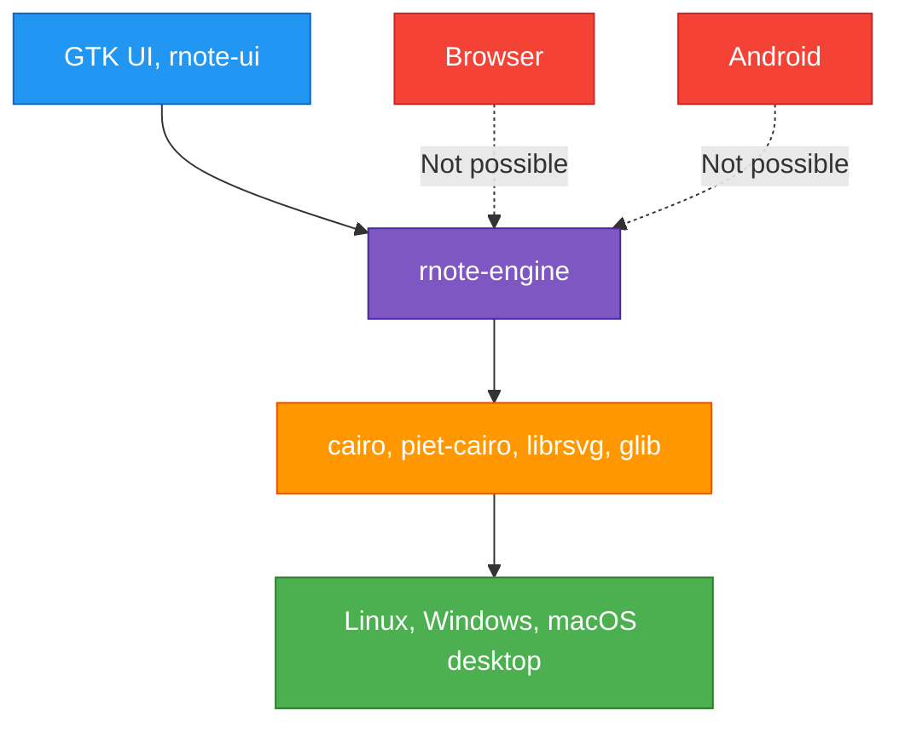
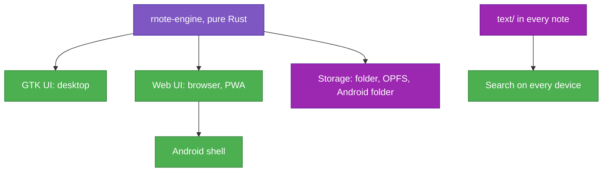
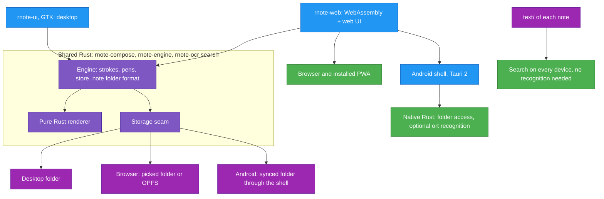

# TASK-006: Web and Android builds from the same codebase — progress

Status: **Planning, nothing implemented (2026-10-11).** Written on branch `feat/packing_and_syncing` while TASK-005 is still open; nothing in the code is touched. Implementation starts on its own branch once TASK-005 is merged. Proposed solution below is not confirmed by the user yet; see "Decisions needed".

## Full initial request (verbatim)

> Don't do anything as we are on other feat branch, but we want to have web builds and android builds. Web should be not too hard with webassembly. Android may be more tricky, but we should use all the available tricks to make a nice notes app sharing the same codebase. Read rnote_ocr_search.md for generatl task structure, then create task template it docs/tasks/task_template.md, then create task_006 for this

## Read first

- `rnote_ocr_search.md` in the repo root: the project rules (never `git stash`, never run `git commit`, temporary files only in `./tmp/`, KISS, structs over tuples, reuse existing UI components and theme variables, no backwards compatibility).
- `docs/tasks/task_005_notes_library_sync_progress.md`: the note folder (`.rnoted`), `text/` with recognised lines that travel with the note, the packed note (`.rnotez`). Both are what makes web and Android cheap: the files are conflict-free and search needs no recognition on the device.
- `docs/tasks/task_010_rnote_file_and_publishing_progress.md`: rename and publishing. A web build needs a name and a place to be hosted.

## Overview

1. **Portable engine**: `rnote-engine`, `rnote-compose` and the search part of `rnote-ocr` build for `wasm32-unknown-unknown` and Android, with no C libraries. Upstream already plans this (`crates/rnote-engine/Cargo.toml:62`: "the long-term plan is to remove the gtk4 dependency entirely after switching to another renderer").
2. **Web build**: the engine as WebAssembly plus a small web UI. Works offline, installable as an app (PWA).
3. **Android build**: the same web UI and engine in an Android shell that adds what a browser cannot: a real notes folder for the sync tool, and optionally recognition on the device.

## User decisions (precise wording)

| Topic | Decision (user's words) |
|---|---|
| Targets | "we want to have **web builds and android builds**" |
| Web | "Web should be not too hard with **webassembly**." |
| Android | "Android may be more tricky, but we should use **all the available tricks** to make **a nice notes app**" |
| Code | "**sharing the same codebase**" |
| Timing | "Don't do anything as we are on other feat branch" → plan only |

## Decisions needed

1. **Android approach.** Options in "Alternative solutions". Recommendation: Solution B (web UI in an Android shell), after a one-day check of GTK's own Android backend (subtask 6.8), which is kept instead if it handles the stylus and files well.
2. **Where the web build keeps notes and how it syncs.** A browser cannot see the folder Google Drive or Syncthing syncs.
   - a. A folder picked by the user (File System Access API). Works with any sync tool on the desktop, Chromium-based browsers only.
   - b. Browser-private storage (OPFS) plus opening and saving `.rnotez`. Works everywhere, no sync.
   - c. A WebDAV server (Nextcloud, `rclone serve webdav`, many NAS). Sync from any browser; the note format already has no conflicts, so a plain file server is enough.
   - d. Google Drive API. Ties the app to one provider, against "Doesn't matter" in TASK-005.

   Recommendation: a and b in this task, c later.
3. **What the first web and Android version must do.** Recommendation: open the library and notes, write with pen, highlighter and eraser, imported Pdfs shown, search over `text/`, save. Settings, export, recognition and the rest of the desktop features come later.
4. **Hosting of the web build.** Tied to TASK-010 (name). Recommendation: static files on GitHub Pages from CI; no server.

## Design principles
- **No backwards compatibility** - Clean implementation, update all code in place
- KISS
- Elegant
- One engine, one file format, on every platform. Only the shell differs.
- A nice notes app: stylus latency and pressure come first.
- Not using too much RAM (TASK-001), which matters even more on phones.

---

## Current analysis

What exists (verified in the code):

- **The engine is already the UI-independent core.** The GTK UI turns input into engine pen events (`crates/rnote-ui/src/canvas/input.rs`, pressure at `:420`) and reacts to the `WidgetFlags` the engine returns. A web or Android UI does the same with its own events.
- **The engine still links C libraries everywhere**, none of which build for `wasm32-unknown-unknown`:

| Dependency | Where | Uses | Role |
|---|---|---|---|
| `cairo-rs` | engine, compose | 91 references in 41 files | Rasterising strokes into images, PDF export |
| `piet-cairo` | engine, compose | 58 references | Drawing strokes through `piet`; text layout of text strokes (`strokes/textstroke.rs:347` and 9 more) through Pango |
| `librsvg` | `svg.rs:184`, `strokes/vectorimage.rs` | 10 | SVG to pixels |
| `glib`, `gio` | `image.rs:79` (`glib::Bytes`), `svg.rs`, `ext.rs`, `notefolder/` | 29 | Byte buffers, memory streams |
| `gtk4`, `rodio` | engine behind feature `ui` | 54, 12 | Drawing into the GTK snapshot, pen sounds |

- **Already pure Rust and portable**: `kurbo`, `parry2d-f64`, `usvg`, `hayro` (Pdf pages), `hayro-write`, `pdf-writer`, `serde_json`, `flate2`, `zip`, `image`.
- **Things that compile for wasm but break at run time**: `std::time::Instant` (17 uses, panics in the browser), `std::thread` in `tasks.rs` (periodic tasks), `rayon` (31 uses), `std::fs` and `tempfile` in `notefolder/` and `utils.rs`.
- **`rnote-ocr`**: the index module always links `rusqlite` with bundled SQLite; recognition (`ort`) is behind feature `recognize`, only the CLI enables it.
- **Search does not need recognition on the device**: since TASK-005 the recognised lines live in each note's `text/`. SQLite is only a local cache built from them, and search already streams every row and matches in Rust (TASK-001).
- **GTK 4.18 has an Android backend** (presented by the GTK maintainers at Linux App Summit 2025). The workspace already uses `gtk4` with feature `v4_18`. How well it handles stylus pressure, Android file access and app size is not known.

### Current Flow

Issues:
- The engine cannot be built for the browser: cairo, Pango, librsvg and glib are C libraries.
- On Android it could be built, but the whole GTK, Pango and cairo stack has to be cross-compiled and shipped with it.
- Storage, timers and threads assume a desktop operating system.

### What needs improving

### Initial solution [to be removed after choosing solution]

GTK everywhere. Android through GTK's Android backend with the existing `rnote-ui`; web through GTK's Broadway backend, which draws a running GTK app into a browser page.
- Changes: build scripts only.
- Risks: Broadway needs the app running on a server for every user, does not work offline and adds network latency to every pen stroke. It is not a web build. Android needs the whole C stack cross-compiled.

### Alternative solutions [to be removed after choosing solution]

All three share Phase 1, the portable engine: replace the C libraries with pure Rust ones and put storage, time and threads behind small seams.

**Solution A — portable engine, web UI, GTK on Android.** New crate `rnote-web` (engine as WebAssembly, a canvas, a small web UI). Android runs the existing `rnote-ui` on GTK's Android backend.
- Changes: engine, compose, ocr; new `rnote-web`; Android build of `rnote-ui` and the GTK stack.
- Risks: GTK's Android backend is new; stylus pressure, Android's file access and the size of the APK are unknown. Rnote's desktop UI was not made for phones (libadwaita adapts, the canvas tools do not).

**Solution B — portable engine, one web UI for web and Android.** Same `rnote-web`. On Android it runs inside a native shell (Tauri 2, which builds Android apps around a WebView with a Rust side). The engine runs as WebAssembly in both places, so drawing code is identical; the Rust side of the shell only adds what a browser lacks: a real notes folder, optionally recognition with `ort`.
- Changes: engine, compose, ocr; new `rnote-web`; new `rnote-android` (shell config and a few native commands).
- Risks: two UIs to keep (GTK on the desktop, web elsewhere). WebView stylus latency is good on recent Android but has to be measured.

**Solution C — portable engine, native UI per platform.** Web as in A and B; Android with a Kotlin (Jetpack Compose) UI calling the engine through generated bindings (UniFFI), drawing with Android's low-latency stylus APIs.
- Changes: as B, plus a Kotlin app.
- Risks: three UIs in two languages; every feature is built three times.

### Solution evaluation [to be removed after choosing solution]

**Initial.** Cheapest, but the web part fails the request: no offline use, a server per user, latency on every stroke.

**Solution A.** Least new UI for Android. Everything rides on a new GTK backend whose stylus and file handling are unknown, and on a desktop UI used on a phone.

**Solution B.** One new UI that serves web, installed web app and Android. The engine even runs the same WebAssembly on both, so a drawing bug is fixed once. Browser pointer events give pressure, tilt, every stylus sample between frames and predicted points. Cost: a second UI next to GTK.

**Solution C.** The best Android result, at three times the UI work and a second language. Against "sharing the same codebase".

Scale: 1 (worst) to 5 (best)

| Metric | Initial | Solution A | Solution B | Solution C |
|--------|:-:|:-:|:-:|:-:|
| Performance | 1 | 4 | 4 | 5 |
| Correctness | 1 | 3 | 4 | 5 |
| Maintainability | 3 | 3 | 4 | 2 |
| Code locality | 4 | 3 | 3 | 2 |
| Codebase consistency | 5 | 4 | 3 | 2 |
| Simplicity of change | 4 | 3 | 3 | 1 |
| **Total** | **18** | **20** | **21** | **17** |

A and B are close and share all of Phase 1 and the web UI, so the choice for Android can wait: subtask 6.8 tries GTK on Android for a day before the Android shell is built.

### Chosen solution implementation details

**Proposed: Solution B, with A checked first in 6.8. Not confirmed by the user yet.**

- **Why this over alternatives**: one engine and one non-desktop UI cover the browser, the installed web app and Android, and none of it depends on a backend whose stylus support is unknown.

**What to change**

1. **Renderer (engine, compose).** Replace cairo and `piet-cairo` with a pure Rust renderer on every platform, desktop included (one path, no backwards compatibility). Candidates, to be decided in 6.1:
   - `vello_cpu` or `tiny-skia` for rasterising; both work in WebAssembly. `kurbo` paths, already used everywhere, go in directly with `vello_cpu`.
   - `resvg` for SVG to pixels, replacing librsvg; `usvg` is already a dependency.
   - `parley` for text layout of text strokes, replacing Pango.
   - Pdf export with notes on top: `svg2pdf` (on top of `usvg`) or the existing `hayro-write` + `pdf-writer`, replacing cairo's PDF surface.
2. **Platform seams (engine).**
   - `Storage` trait for `notefolder/`: list, read, write, delete by path inside a note. Implementations: `std::fs` (desktop, Android shell), File System Access and OPFS (web). `tempfile` only in the desktop implementation.
   - `web-time` instead of `std::time::Instant`.
   - `rayon` behind a feature, off on the web (threads in the browser need cross-origin isolation headers; possible later with `wasm-bindgen-rayon`).
   - Periodic tasks (`tasks.rs`) driven by the UI's timer instead of a thread of their own.
   - `glib::Bytes` → `Vec<u8>` or `bytes::Bytes`.
3. **Drawing to the screen (engine).** Today the engine draws into a GTK snapshot behind feature `ui`. Split it into what to draw (stroke images, tiles, overlays, positions) and how: GTK keeps its snapshot code, the web draws the same list onto a canvas.
4. **`rnote-ocr`.** SQLite and `ort` both native only. On the web, search builds its rows from the `text/` files of the notes in memory; matching is the existing Rust code. Recognition is not done in the browser.
5. **`rnote-web` (new crate).** `wasm-bindgen` API over the engine; web UI kept small (plain TypeScript or a Rust UI framework, decided in 6.5). Input through pointer events:
   - `pointerType` tells pen, touch and mouse apart: palm rejection, and touch scrolls while the pen draws.
   - `pressure`, `tiltX`/`tiltY` into the engine's pen events, as `input.rs` does now.
   - `getCoalescedEvents()` for every stylus sample between frames; `getPredictedEvents()` to draw slightly ahead of the pen.
   - Canvas with `desynchronized: true` for lower latency; `touch-action: none` on the canvas.
   - A service worker for offline use and the web app manifest, so it installs as an app on Android, iPad and desktops.
6. **Android shell (new, `rnote-android`).** Tauri 2 Android project around the `rnote-web` bundle. Native commands: open a notes folder the sync tool fills (Syncthing, Drive apps), read and write files in it, and later recognition with `ort` and the PP-OCRv5 mobile models. Stylus input stays in the WebView; the engine stays WebAssembly, so web and Android behave the same.
7. **Build.** `just` recipes and CI jobs for the WebAssembly bundle (`wasm-pack` or `trunk`) and the APK. Cargo still only through meson where the native crates are built.

**Existing patterns to follow**
- Input to engine pen events: `crates/rnote-ui/src/canvas/input.rs`
- Engine reacting with `WidgetFlags`: `crates/rnote-engine/src/widgetflags.rs`
- Feature-gated heavy dependencies: `recognize` in `crates/rnote-ocr/Cargo.toml`, `ui` in `crates/rnote-engine/Cargo.toml`
- Note folder files: `crates/rnote-engine/src/notefolder/`

**Edge cases**
- Typed Traditional Chinese in text strokes on the web → the browser has no system font access from WebAssembly; a CJK font has to be loaded (large: tens of MB for full Noto Sans TC; load on first need, cache in the service worker).
- Notes with big Pdfs → `hayro` draws pages on demand; the per-device page cache of TASK-005 lives in OPFS on the web.
- A note open in the browser and changed on the desktop at the same time → the note format already merges by stroke stamp; the web just reloads `ink/`.
- Browser clears site storage → only OPFS notes are at risk; a picked folder is not. The UI says where notes live.
- Safari and Firefox → no File System Access; OPFS and `.rnotez` only.
- Device id (TASK-005, one per installation) → one per browser profile and per Android install.

**Files to modify**

| File | Change | Status |
|---|---|---|
| `Cargo.toml` | Remove cairo, piet-cairo, librsvg from engine and compose; add renderer, `resvg`, `parley`, `web-time`; add `rnote-web` | Not started |
| `crates/rnote-compose/src/` | Drawing through the new renderer | Not started |
| `crates/rnote-engine/src/svg.rs`, `image.rs`, `strokes/` | Renderer, `resvg`, no `glib` | Not started |
| `crates/rnote-engine/src/strokes/textstroke.rs` | `parley` text layout | Not started |
| `crates/rnote-engine/src/engine/export.rs` | Pdf and bitmap export without cairo | Not started |
| `crates/rnote-engine/src/engine/rendering.rs` | Split draw list from GTK snapshot | Not started |
| `crates/rnote-engine/src/notefolder/` | `Storage` trait | Not started |
| `crates/rnote-engine/src/tasks.rs` | Periodic tasks without a thread | Not started |
| `crates/rnote-ocr/` | SQLite native only, search from `text/` | Not started |
| `crates/rnote-ui/` | Adapt to the engine changes | Not started |
| `crates/rnote-web/` | New crate and web UI | Not started |
| `crates/rnote-android/` | New Android shell | Not started |
| `justfile`, `.github/workflows/` | Web and Android builds | Not started |

**Out of scope**
- Recognition in the browser (`ort-web` exists, see Gotchas; search works without it).
- iOS app (the PWA works on iPad as a start).
- Replacing the GTK desktop UI with the web UI (possible later: the same shell also builds desktop apps).
- Sync to a server (option c of decision 2), unless chosen.

## Subtasks

| ID | Description | Status | File |
|----|-------------|--------|------|
| 6.1 | Check: build engine and compose for `wasm32-unknown-unknown`, list every blocker; pick the renderer | Not started | |
| 6.2 | Engine and compose: pure Rust renderer, `resvg`, `parley`; desktop uses it, output compared with the old on the sample notes | Not started | |
| 6.3 | Engine: `Storage`, `web-time`, `rayon` feature, tasks without a thread, no `glib` | Not started | |
| 6.4 | Engine: draw list apart from the GTK snapshot | Not started | |
| 6.5 | `rnote-web`: open a `.rnotez`, write with the pen, save to OPFS | Not started | |
| 6.6 | Web: library on a picked folder, search from `text/` | Not started | |
| 6.7 | Web: offline and installable (PWA) | Not started | |
| 6.8 | Check: `rnote-ui` on GTK's Android backend for a day: pressure, latency, folder access, APK size | Not started | |
| 6.9 | Android shell around `rnote-web` with access to the synced folder | Not started | |
| 6.10 | Builds: `just` recipes and CI for web and APK | Not started | |
| 6.11 | Android: recognition on the device with `ort` | Later | |

Subtasks 6.1 to 6.4 change nothing visible on the desktop and are worth doing even if the rest waits. After 6.7, Android already has an installable app without the shell.

## Instructions

- Run `just fmt-check` and `just lint` on files
- if UI/UX changed, make sure to show specific changes and give paths to screenshots. Keep them in `./tmp/`.
- Before 6.2 is called done, render every note in `sample_docs/` and the TASK-005 test notes with the old and the new renderer and compare the images in `./tmp/`.
- Measure stylus latency and dropped samples on a real Android tablet in 6.8 and 6.9; numbers go into Gotchas.

### Gotchas (learned the hard way)

- **`ort-web` (WebAssembly backend of `ort`) is version 0.1**, supports only `run_async`, loads the ONNX Runtime from a CDN by default and has telemetry on by default. Not used in this task.
- **SQLite in the browser needs a worker**: `sqlite-wasm-rs` stores in OPFS only from a dedicated worker. Avoided by searching `text/` in memory on the web.
- **`std::time::Instant` compiles for the web and panics when called.**

## Open points

- Renderer: `vello_cpu` or `tiny-skia` (6.1).
- Web UI technology: plain TypeScript or a Rust UI framework (6.5).
- Whether Chrome on Android supports picking a folder (File System Access); if not, Android notes need the shell from the start.
- Tauri 2 Android: access to a folder outside the app, which Android limits (storage access framework); how Syncthing users point the app at their folder.
- Size of the WebAssembly bundle with `hayro`, `parley` and the renderer.
- Name and hosting, with TASK-010.

## Log

- 2026-10-11: Plan written, nothing implemented.
