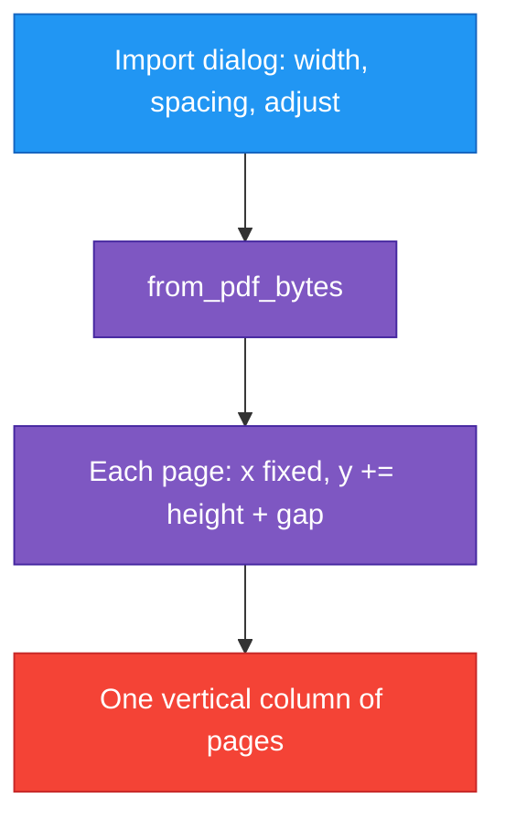
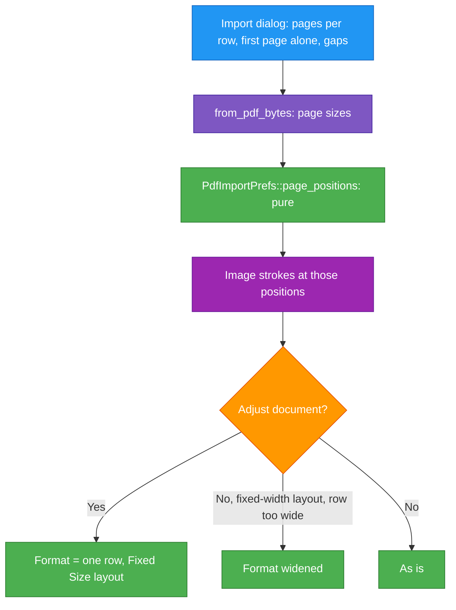

# TASK-011: Layout of imported Pdf pages (spreads, grid, gaps) — progress

Status: **Done, not committed (2026-11-15).** Layout options, live preview in the dialog, CLI flags. fmt, clippy and tests pass. Checked in the app (headless): the preview with real pages of the user's encrypted textbook in light and dark theme, and the imported pages' rendered bitmaps at the new positions. The window screenshot after import shows pink blocks; that is the screenshot renderer of the headless run, see Gotchas. The "New folder" request is TASK-012 (`docs/tasks/task_012_new_folder_progress.md`).

## Full initial request (verbatim)

> proceed to implement this change in rnote: Choose import layout. pages side by side imported or grid or something. Spacing. So that it could open as proper book as now it opens as one vertical line of pages if it makes sense. ... Checkout in branch there ofc. Only touch import of PDFs.

Later request, done as its own task on the same branch (TASK-012):

> Allow to create new folder via rnote browsing sidebar (where the three dot menu allows to open, rename, move to trash etc, should allow to also create new folder)

## Read first

- `rnote_ocr_search.md` in the repo root: the project rules (never `git stash`, never run `git commit`, temporary files only in `./tmp/`, KISS, structs over tuples, reuse existing UI components and theme variables, no backwards compatibility).
- `docs/tasks/task_003_pdf_text_import_progress.md`: the text of a Pdf page is stored as fractions of the page image, so it follows wherever the page is placed.
- `docs/tasks/task_005_notes_library_sync_progress.md`: the Pdf is kept and its pages refer to it (`PdfPageRef`); page export orders pages top to bottom, then left to right.

## Overview

1. The Pdf import dialog gets a page layout: how many pages per row, whether the first page sits alone like a book cover, and the gaps between pages and between rows. 1 page per row is the old behaviour, 2 gives book spreads, more gives a grid.
2. A live preview at the top of the dialog shows the first two rows of the chosen pages, drawn from the Pdf and placed exactly as the import will place them.

## User decisions (precise wording)

| Topic | Decision (user's words) |
|---|---|
| Layout | "pages side by side imported or grid or something" → one "Pages per Row" setting covers vertical (1), book (2) and grid (3+) |
| Book | "So that it could open as proper book" → "First Page Alone" puts page 1 alone on the right, so spreads pair up as printed |
| Spacing | "Spacing." → "Gap Between Pages" and "Gap Between Rows" next to the existing "Page Spacing" |
| Scope | "Only touch import of PDFs." |
| Branch | "Checkout in branch there ofc." → `pdf-import-layout` from `main` |
| Preview | Asked "Is there a preview of import options with real pdf of first few pages?" (there was none; a preview was proposed) → "It has to implement a nice preview, go." |
| Cover | The user's PDFs start with the cover and they will use First Page Alone **off**: page 1 on the left, so the first lesson page lands where it is in print |

## Decisions needed

None. Choices made without the user, open to change:
1. "First Page Alone" is off by default, as the user will use it.
2. The page column follows the page's number in the Pdf, not its place in the chosen range, so importing pages 4–9 of a book still puts even pages on the left.
3. With a fixed-width document layout (Fixed Size, Continuous Vertical) and "Adjust Document" off, a row wider than the document widens the format, keeping the left margin on the right too. Otherwise the pages would stick out of the document.

## Design principles
- **No backwards compatibility** - Clean implementation, update all code in place
- KISS
- Elegant
- Only the Pdf import path changes

---

## Current analysis

Before this task (on `main`), both `VectorImage::from_pdf_bytes` and `BitmapImage::from_pdf_bytes` placed pages in one loop with `y += height + 16` (continuous), `y += format.height()` (one per document page) or `y += height` (adjust document). `x` never changed. With "Adjust Document", `import_generated_content` set the format to the largest page and switched to the Fixed Size layout.

### Current Flow



Issues:
- A book opens as one long column; spreads cannot be seen side by side.
- The gap between pages is a hard-coded 16.
- Page placement was duplicated in the vector and bitmap import.

### What needs improving



### Chosen solution implementation details

**Chosen: one "Pages per Row" number plus a "First Page Alone" switch**, instead of a Vertical / Book / Grid choice. Columns = 1 is the old vertical layout, 2 is a book, 3+ a grid; one setting and one code path.

How positions are computed (`PdfImportPrefs::page_positions`, `crates/rnote-engine/src/engine/import.rs:156`):
- Input: the pages to import in Pdf order, each its Pdf index and its size on the document (`PdfPageToPlace`, `import.rs:135`), the insert position and the document page height.
- Slot of a page = Pdf index + (columns − 1 if first page alone, else 0). Column = slot mod columns, row = slot div columns, counted from the first imported page's row.
- All columns are as wide as the widest page; x = origin + column × (column width + column gap).
- A row is as high as its highest page. The next row starts after: row height + row gap (continuous spacing), one document page height (one per document page), or the highest page of the import (adjust document; the format becomes that high, so each row is one document page).
- All pages of a row share the same top, so the page export of task 005 (sorted by y, then x) keeps reading order.

Document layout (`Engine::import_generated_content`, `import.rs:415`):
- Adjust Document: format width = right edge of the pages (the whole row, gaps included), height = highest page; layout Fixed Size. Each spread is one document page.
- Not adjusted, Fixed Size or Continuous Vertical layout, and the pages reach past the format width: format width = right edge + left margin. Infinite and Semi-Infinite need nothing.

Text and kept Pdf: unchanged. Text lines are fractions of the page rectangle (task 003) and `PdfPageRef` is per stroke (task 005), so both follow the new positions without code changes.

**Preview** (`crates/rnote-ui/src/dialogs/pdfpreview.rs`, new; wired in `dialogs/import.rs` after the rows' own handlers)
- A `GtkDrawingArea` (280 px high) in a `card` above the settings, with a caption below it (`caption`, `dim-label`). The settings and the Pdf info are in a `GtkScrolledWindow` under it, so the preview stays in view while the rows scroll and the dialog fits a small screen.
- Shows the pages that fill the first two rows from Start Page (`PdfImportPreview::shown_pages`), placed with `PdfImportPrefs::page_positions` and the same page zoom as the import (`PdfImportPreview::layout`), so preview and import cannot disagree.
- Each page is drawn once with `hayro::render` at 240 px wide on a rayon thread, on a white background, and kept per page index while the dialog is open (`draw_thumbnail`). Until it arrives a placeholder card is drawn. Changing the layout only redraws the cards; changing the range draws only pages not drawn yet.
- Page cards: rounded corners, a soft shadow in the theme's foreground colour, a page-number pill in the accent colour (`adw::StyleManager::accent_color_rgba`). The document width is a dashed outline, so a row wider than the document shows; with one row per document page the page breaks are dashed lines too.
- Caption, for example "Pages 10–12 of 10–15 · 2 per row · odd pages on the left". With a fixed-width document layout and a row wider than the document it adds "wider than the document, which is widened".
- Encrypted Pdfs work: the preview uses the Pdf the dialog already opened (with the password if one was asked). Checked on `textbook-A.pdf`, AES-256 encrypted with an owner password.

**Files changed**

| File | Change | Status |
|---|---|---|
| `crates/rnote-engine/src/engine/import.rs` | `columns`, `first_page_alone`, `column_gap`, `row_gap` in `PdfImportPrefs`; `PdfPageToPlace`; `page_positions`; format handling in `import_generated_content`; 6 unit tests | Done |
| `crates/rnote-engine/src/strokes/vectorimage.rs` | `from_pdf_bytes` places pages with `page_positions` (`:444`) | Done |
| `crates/rnote-engine/src/strokes/bitmapimage.rs` | Same (`:230`) | Done |
| `crates/rnote-ui/data/ui/dialogs/import.ui` | Rows "Pages per Row", "First Page Alone", "Gap Between Pages", "Gap Between Rows" (`AdwSpinRow`, `AdwSwitchRow` like the existing rows) and their adjustments; preview card on top, the rest in a scrolled view | Done |
| `crates/rnote-ui/src/dialogs/pdfpreview.rs` (new), `dialogs/mod.rs`, `src/meson.build` | The preview | Done |
| `crates/rnote-ui/src/dialogs/import.rs` | Wire the rows to the prefs; "First Page Alone" and "Gap Between Pages" insensitive with 1 page per row; "Gap Between Rows" only with continuous spacing and without Adjust Document; the Pdf is held in an `Arc` and shared with the preview, which is updated by every row that changes pages or layout | Done |
| `crates/rnote-cli/src/cli.rs`, `import.rs` | `rnote-cli import --pdf-columns N --pdf-first-page-alone BOOL --pdf-adjust-document` | Done |

Prefs are remembered like the other Pdf import prefs: they are part of the engine config, saved as JSON in the `engine-config` settings key. No schema change; `#[serde(default)]` fills the new fields for older settings.

**Edge cases**
- Page range starting mid-book → spreads still pair as in the Pdf (unit test `spreads_pair_up_as_in_the_pdf_when_starting_later`).
- Only page 1 imported with 2 columns and first page alone → it sits in the right column; with Adjust Document the format is two pages wide.
- Mixed page sizes → columns as wide as the widest page; pages are top-left aligned in their cell.
- One page per document page with pages taller than the document page → overlap, as before.

**Out of scope**
- Other import types, document format beyond the prefs.
- Right-to-left books (page 1 on the left side).

## Subtasks

| ID | Description | Status | File |
|----|-------------|--------|------|
| 11.1 | Engine: pure `page_positions`, used by vector and bitmap import, tests | Done | `engine/import.rs` |
| 11.2 | Engine: document format for rows (adjust and fixed-width layouts) | Done | `engine/import.rs` |
| 11.3 | UI: dialog rows and prefs | Done | `dialogs/import.rs`, `import.ui` |
| 11.4 | CLI flags | Done | `rnote-cli` |
| 11.5 | Check in the app, screenshots | Done (headless, see Gotchas) | `tmp/layout/` |
| 11.6 | Live preview in the dialog | Done | `dialogs/pdfpreview.rs` |

## Instructions

- Run `just fmt-check` and `just lint` on files
- if UI/UX changed, make sure to show specific changes and give paths to screenshots. Keep them in `./tmp/`.

### Gotchas (learned the hard way)

- **Builds starve the user's screen sharing.** Run every cargo, meson, `just lint` and test command as `nice -n 19 ionice -c3` with `CARGO_BUILD_JOBS=4` (or `-j 4`).
- **The user's own Rnote may be running** (same app id). `misc/ui-testing/run_ui.sh` then refuses to start, and `atspi.py` would talk to the user's app. Here the dev build ran in its own D-Bus session on a Broadway display (`tmp/layout/headless.sh` under `dbus-run-session`), invisible and separate. Broadway has no AT-SPI, so `atspi.py` does not work there; a temporary `click LABEL` hook in `testhooks.rs` pressed the dialog's Import button.
- **Settings for a headless run** come from a keyfile (`GSETTINGS_BACKEND=keyfile`, `XDG_CONFIG_HOME=tmp/layout/ui/config`); a partial `engine-config` JSON is enough since the config is `#[serde(default)]`.
- **`testhooks.rs` is not in `crates/rnote-ui/src/meson.build`**, so `meson compile` does not rebuild after changing only that file. Touch a listed file.
- **`just fmt-check` fails on this machine** because `find . -name meson.build` also finds files under `tmp/venv` and `_mesonbuild/cargo-home`. On tracked files (`git ls-files '*meson.build' | xargs meson format -q`) it passes, and `cargo fmt --check` passes.
- **`just lint` ends with exit 127**: `yamllint` is not installed. Both clippy runs before it are clean; `yamllint` from `tmp/venv` on the tracked YAML files is clean.
- **The sample textbook is encrypted** (owner password), so `pdfunite` refuses it. `gs -sDEVICE=pdfwrite -dFirstPage=1 -dLastPage=7` makes a 7-page test copy (`tmp/layout/book7.pdf`).
- **Pink blocks in window screenshots of the headless run are not a bug in the import.** The render node tree written next to each screenshot holds the page textures (format `RGBA8p`) at the new positions with the real page content; `tmp/layout/tools/node_pages.py` composites them (`tmp/layout/document_*_pages.png`). The same pink shows when opening an existing note with Pdf pages without importing anything (no dialog, no layout code), and in both page drawing modes (converted and straight from the Pdf). GTK's cairo renderer draws these texture nodes as hot pink (255, 105, 180) in this setup; Broadway has no GL. The exact reason inside GTK was not found (a guess: the document clip around the pages is taller than cairo's 32767 px limit). Not checked on a real display, where the GL renderer draws.
- **Zoom actions had no visible effect** in the headless run (`zoom-out`, `zoom-fit-width`); the canvas stayed at its zoom.
- **Broadway's default colour scheme was dark** here; for a light screenshot set `color-scheme='force-light'` in the keyfile. Setting `adw::StyleManager` from a hook panicked in an existing settings binding (`Source property state expected type GVariant`), so the keyfile is the way.
- The headless runner (`tmp/layout/headless.sh`, `tmp/layout/run_case.sh`) and the temporary hooks (`click LABEL`, `spin TITLE VALUE`, screenshots through a cairo renderer that also write the node tree) were used for checking only; the hooks are reverted, `testhooks.rs` is as on `main`.
- Exporting the imported note with `rnote-cli export doc` to SVG and rasterising it gave blank images, and `export doc-pages --export-format png` of a test copy made with ghostscript gave black pages for several pages also with 1 page per row, so not from this change. Not followed further; the app path above was checked instead.
- **The index had changes staged** by someone else during the work (the first version of the engine, dialog and CLI changes, plus the temporary hook in `testhooks.rs`). The hook was unstaged and reverted with `git restore --staged --worktree --source=HEAD crates/rnote-ui/src/testhooks.rs`; the other staged files were left alone and are older than the working tree.

## Open points

- Not seen on a real display (X11/Wayland with GL): the user's own Rnote was running with the same app id, and a test window would have shown up during screen sharing.
- Adjust Document with 2 columns: checked through `rnote-cli import --pdf-adjust-document` (format 2 pages + gap wide, 4 rows for 7 pages, cover at x = 1139), not in the app.
- The dialog was only seen 1024×768 (Broadway's size); at 1080p it should show more rows without scrolling.

## Log

- 2026-11-15: branch `pdf-import-layout` from `main`. Engine, dialog, CLI implemented; 6 unit tests; fmt and clippy clean; app dialog and an import with 2 pages per row seen in headless screenshots.
- 2026-11-15: user asked for a preview, then "It has to implement a nice preview, go." Preview built; checked with `textbook-A.pdf` pages 10–15, 2 per row, First Page Alone off, light and dark. Pink blocks after import traced to the headless screenshot renderer.

## Result

### Where things are

See "Files changed" above.

### Differences from the plan

The task asked for Vertical / Book / Grid; one "Pages per Row" number covers all three. The preview was added on the user's request during the task.

### Checked

| Check | Result |
|---|---|
| `cargo test -p rnote-engine --lib` | 50 passed, 6 of them new (`engine::import::tests`) |
| clippy (ui, cli) via `just lint` | clean |
| `cargo fmt --check`, `meson format` on tracked files | clean |
| `rnote-cli import` of 7 textbook pages, 2 columns, adjust document | document 2 pages + gap wide, 4 rows |
| App, dialog with preview, light | `tmp/layout/preview_light.png` |
| App, dialog with preview, dark | `tmp/layout/preview_dark.png` |
| App, pages after import (pages 10–15, 2 per row, First Page Alone off, gaps 24/48), from the render nodes, drawn from the Pdf | `tmp/layout/document_light_pages.png`, `tmp/layout/document_dark_pages.png` (3 textures in view: 10 on the right, 11 and 12 below) |
| Same with the default "converted and cached" drawing | `tmp/layout/document_converted_pages.png` (page 10; the others were still being converted) |
| Window screenshots after import, renderer issue | `tmp/layout/document_*_screen_headless_renderer_pink.png` |
| Encrypted Pdf (owner password, AES-256) | preview and import work |

## Commit suggestion

Commit this before TASK-012. `crates/rnote-ui/src/meson.build` holds both tasks' new files; add only the `pdfpreview.rs` line here with `git add -p`:

```
git add crates/rnote-engine crates/rnote-cli crates/rnote-ui/src/dialogs crates/rnote-ui/data/ui/dialogs/import.ui docs/tasks/task_011_pdf_import_layout_progress.md
git add -p crates/rnote-ui/src/meson.build
git commit \
  -m "TASK-011 feat(import): Lay out imported Pdf pages in rows, as book spreads or a grid, with a live preview" \
  -m "Why: Books imported as one long column could not be read as spreads." \
  -m "- Add Pages per Row, First Page Alone, Gap Between Pages and Gap Between Rows to the Pdf import dialog
- Preview the first two rows of the chosen pages in the dialog, drawn from the Pdf and placed like the import
- Place pages with one pure function shared by vector and bitmap import, with tests
- Make a row one document page when the document is adjusted; widen fixed-width documents that a row does not fit
- Add --pdf-columns, --pdf-first-page-alone and --pdf-adjust-document to rnote-cli import"
```
