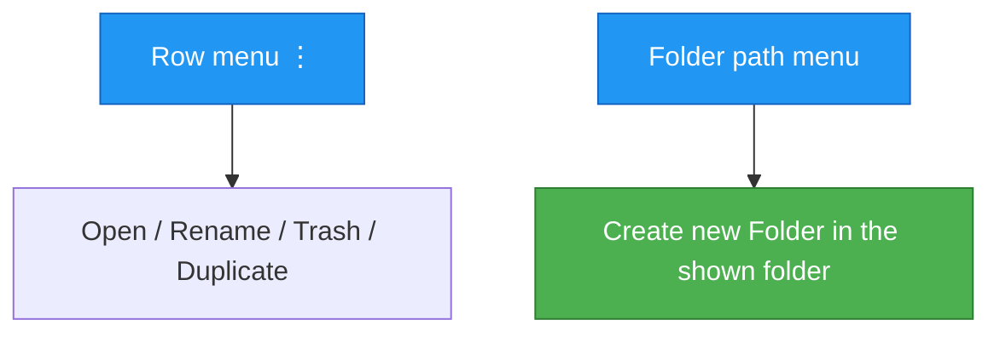
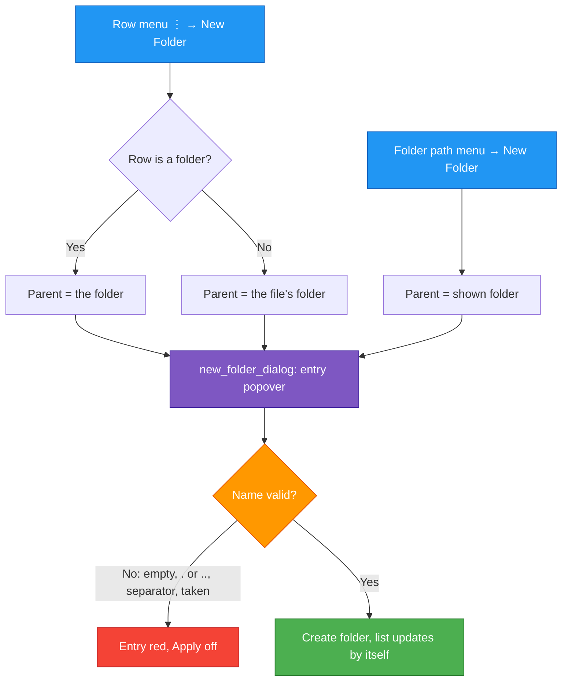

# TASK-012: New folder from the file browser's row menu — progress

Status: **Done, not committed (2026-11-15).** "New Folder" is in the three-dot menu of every row of the file browser, and the existing entry in the menu of the shown folder uses the same dialog. Builds, clippy and fmt clean, one unit test. Checked in the app headless, see "Checked". Same branch as TASK-011 (`pdf-import-layout`), separate commit.

## Full initial request (verbatim)

> Allow to create new folder via rnote browsing sidebar (where the three dot menu allows to open, rename, move to trash etc, should allow to also create new folder)

Relayed by the coordinator with these details: on a folder row it creates a subfolder inside that folder; on a file row, in the file's parent folder. Ask for the name with the kind of dialog Rename uses, refuse empty names, existing names and path separators, refresh the list. Also consider the menu of the browser's current folder, so it works in an empty folder.

## Read first

- `rnote_ocr_search.md` in the repo root: the project rules (never `git stash`, never run `git commit`, temporary files only in `./tmp/`, KISS, structs over tuples, reuse existing UI components and theme variables, no backwards compatibility).
- `docs/tasks/task_005_notes_library_sync_progress.md`: the library is a folder of notes; folders in it are plain folders.

## Overview

1. Row menu entry "New Folder" (`filerow.new-folder`): inside the row's folder, or next to the row's file.
2. One dialog for it and for the existing "New Folder" of the shown folder (`workspacebrowser.create-folder`, the menu next to the folder path, which already worked in an empty folder).

## User decisions (precise wording)

| Topic | Decision (user's words) |
|---|---|
| Where | "where the three dot menu allows to open, rename, move to trash etc, should allow to also create new folder" |

## Decisions needed

None.

## Design principles
- **No backwards compatibility** - Clean implementation, update all code in place
- KISS
- Elegant
- Reuse the existing entry popover (`widgethelper::create_entry_dialog`), as Rename and the existing folder action do

---

## Current analysis

- The row menu (`crates/rnote-ui/data/ui/filerow.ui`) had Open, Open in Default App, Rename, Move to Trash, Duplicate. Actions live in `crates/rnote-ui/src/workspacebrowser/filerow/actions/`.
- The menu next to the shown folder's path already had "Create new Folder" (`workspaceactions/createfolder.rs`): an entry popover from `widgethelper::create_entry_dialog`, refusing empty and existing names, but not path separators: "a/b" failed with a toast when `a` did not exist, and made a folder inside `a` when it did.
- The file list is a `GtkDirectoryList` that follows the file system, so a new folder appears without a refresh call.



### New flow



**Files changed**

| File | Change | Status |
|---|---|---|
| `crates/rnote-ui/src/workspacebrowser/workspaceactions/createfolder.rs` | `new_folder_dialog(parent, host, appwindow)` shared by both entries; `is_valid_folder_name` (not empty, not `.`/`..`, no path separator, not taken; name trimmed); title "New Folder in “parent”"; Enter in the entry applies; unit test | Done |
| `crates/rnote-ui/src/workspacebrowser/workspaceactions/mod.rs` | Export `new_folder_dialog` | Done |
| `crates/rnote-ui/src/workspacebrowser/filerow/actions/new_folder.rs` (new), `actions/mod.rs`, `filerow/mod.rs` | `filerow.new-folder` action | Done |
| `crates/rnote-ui/data/ui/filerow.ui` | "New Folder" in its own section at the end of the row menu | Done |
| `crates/rnote-ui/data/ui/workspacebrowser.ui` | "Create new Folder" renamed "New Folder" | Done |
| `crates/rnote-ui/src/meson.build` | New source | Done |

**Edge cases**
- Empty folder: the row menu needs a row; the folder path menu ("New Folder") covers it, as before.
- Name with surrounding spaces → trimmed.
- Folder removed while the dialog is open → creating fails with the existing "Creating new folder failed" toast.

## Subtasks

| ID | Description | Status | File |
|----|-------------|--------|------|
| 12.1 | Shared dialog with name checks | Done | `createfolder.rs` |
| 12.2 | Row menu entry and action | Done | `filerow/actions/new_folder.rs`, `filerow.ui` |
| 12.3 | Check in the app | Done (headless) | `tmp/newfolder/` |

## Instructions

- Run `just fmt-check` and `just lint` on files
- if UI/UX changed, make sure to show specific changes and give paths to screenshots. Keep them in `./tmp/`.

### Gotchas (learned the hard way)

- Builds run as `nice -n 19 ionice -c3` with `CARGO_BUILD_JOBS=4`, so the user's screen sharing keeps working.
- The headless check (Broadway in its own D-Bus session, see TASK-011) cannot open the row's menu by mouse; temporary hooks activated `filerow.new-folder` on a row by name, typed into the popover's entry and pressed Apply. They are reverted. Popovers are surfaces of their own and are captured separately.
- The unit test of `rnote-ui` runs with meson's environment: `CARGO_HOME=_mesonbuild/cargo-home cargo test --target-dir _mesonbuild/target -p rnote createfolder`.

## Open points

- Not seen on a real display.

## Log

- 2026-11-15: built and checked as below.

## Result

### Checked

| Check | Result |
|---|---|
| clippy (ui), `cargo fmt --check`, `meson format` on tracked files | clean |
| Unit test `folder_names_are_single_new_components` | passes |
| App: row menu → New Folder on folder `Lessons`, name "Week 1" | `tmp/newfolder/ws/Lessons/Week 1` created; popover `tmp/newfolder/popover_folder_row.png` |
| App: row menu → New Folder on file `notes.rnote`, name "Lessons" (taken) | entry red, Apply off: `tmp/newfolder/popover_taken_name.png` |
| Same with "a/b" | entry red, Apply off: `tmp/newfolder/popover_separator.png` |
| Same with "Drafts" | `tmp/newfolder/ws/Drafts` created next to the file |
| Row menu with the new entry | `tmp/newfolder/row_menu.png` |
| Window after (Drafts and Lessons listed) | `tmp/newfolder/window_after.png` |

## Commit suggestion

Stage only this task's files; `crates/rnote-ui/src/meson.build` also holds TASK-011's new file, so add its `new_folder.rs` line with `git add -p`:

```
git add crates/rnote-ui/src/workspacebrowser crates/rnote-ui/data/ui/filerow.ui crates/rnote-ui/data/ui/workspacebrowser.ui docs/tasks/task_012_new_folder_progress.md
git add -p crates/rnote-ui/src/meson.build
git commit \
  -m "TASK-012 feat(ui): Add New Folder to the file browser's row menu" \
  -m "Why: Folders could only be made in the shown folder, from the menu next to its path." \
  -m "- New Folder on a folder row creates inside it, on a file row next to the file
- One name dialog for the row menu and the folder menu; refuse empty, taken, . and .. and names with a path separator"
```
