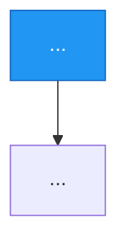
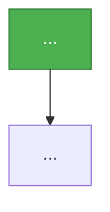
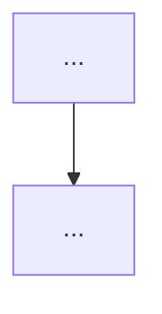

# TASK-<id>: <Title> — progress

Status: **<Not started | Planning, nothing implemented | Subtask N.M in progress | Done> (<YYYY-MM-DD>).** <One or two sentences: what works, what is open, what is committed.>

## Full initial request (verbatim)

> <The user's request, copied as is. Add every later message that changed the task, each as its own quote, in order.>

## Read first

- `rnote_ocr_search.md` in the repo root: the project rules (never `git stash`, never run `git commit`, temporary files only in `./tmp/`, KISS, structs over tuples, reuse existing UI components and theme variables, no backwards compatibility).
- <Other task docs or READMEs this task builds on, with one line on why.>

## Overview

<What the task delivers, in two to five lines. Numbered parts when there are several.>

## User decisions (precise wording)

| Topic | Decision (user's words) |
|---|---|
| <Topic> | "<Quote>" → <what it means for the design, only when not obvious> |

## Decisions needed

<Numbered questions for the user, each with the options and a recommendation. "None." when there are none.>

## Design principles
- **No backwards compatibility** - Clean implementation, update all code in place
- KISS
- Elegant
- <Task-specific principle taken from the user's words>

---

## Current analysis

<What exists today, verified in the code, with `file:line` references.>

### Current Flow



Issues:
- <What is wrong or missing.>

### What needs improving



### Initial solution [to be removed after choosing solution]

<The first idea.>
- Changes: <crates and areas touched>
- Risks: <what can go wrong>

### Alternative solutions [to be removed after choosing solution]

**Solution A — <name>.** <Description.>
- Changes: <...>
- Risks: <...>

**Solution B — <name>.** <Description.>
- Changes: <...>
- Risks: <...>

### Solution evaluation [to be removed after choosing solution]

**Initial.** <Assessment.>

**Solution A.** <Assessment.>

**Solution B.** <Assessment.>

Scale: 1 (worst) to 5 (best)

| Metric | Initial | Solution A | Solution B |
|--------|:-:|:-:|:-:|
| Performance | | | |
| Correctness | | | |
| Maintainability | | | |
| Code locality | | | |
| Codebase consistency | | | |
| Simplicity of change | | | |
| **Total** | | | |

### Chosen solution implementation details

**Proposed: <Solution>. Not confirmed by the user yet.**

- **Why this over alternatives**: <one or two sentences>



**What to change**

1. **<Area or crate>.** <What and how.>

**Existing patterns to follow**
- <Pattern>: `<file:line>`

**Edge cases**
- <Case> → <behaviour>

**Files to modify**

| File | Change | Status |
|---|---|---|
| `<path>` | <change> | Not started |

**Out of scope**
- <Item>

## Subtasks

| ID | Description | Status | File |
|----|-------------|--------|------|
| <id>.1 | <Description> | Not started | |

## Instructions

- Run `just fmt-check` and `just lint` on files
- if UI/UX changed, make sure to show specific changes and give paths to screenshots. Keep them in `./tmp/`.

### Gotchas (learned the hard way)

- <Fill in while working: measured facts, traps, what did not work and why.>

## Open points

- <Things to find out while building.>

## Log

- <YYYY-MM-DD>: <What was done.>

## Result

<Filled in when done.>

### Where things are

### Differences from the plan

### Checked

## Commit suggestion

At the end of every task or subtask, emit a **Suggested commit** block with a ready-to-paste `git commit`. Never run it.

**Shape:** `TASK-<id> <type>(<scope>): <specific subject>` — imperative, names the surface, no period.

**Grow the body only when the subject leaves something out.** Let these three examples be the spec.

> **Form:** use **repeated `-m` flags** — each `-m` becomes a blank-line-separated paragraph. Works in fish, bash, and zsh. Avoid bash heredocs (`<<'EOF'`): they don't work in fish.

Trivial fix — subject says everything:
```
git commit -m "TASK-<id> fix(<scope>): <Subject>"
```

Small diff, but the *why* isn't in the code — add one `Why:` line:
```
git commit \
  -m "TASK-<id> perf(<scope>): <Subject>" \
  -m "Why: <Reason not visible in the code.>"
```

Multi-concern or design-heavy — `Why:` plus bullets (bullets go in one `-m` so the blank line separating them from the Why stays intact):
```
git commit \
  -m "TASK-<id> feat(<scope>): <Subject>" \
  -m "Why: <Reason.>" \
  -m "- <Change one>
- <Change two>
- <Change three>"
```

**Optional trailers** (only when they add info the subject doesn't):
```
Subtask: <id>.<n>
```
Skip the `Task:` trailer — it'd repeat the subject. Skip the whole block if nothing applies.

If the subject reads like `Fix height progress` or `Update sys info`, rewrite it before picking a shape — a vague subject isn't a reason to add a body.
